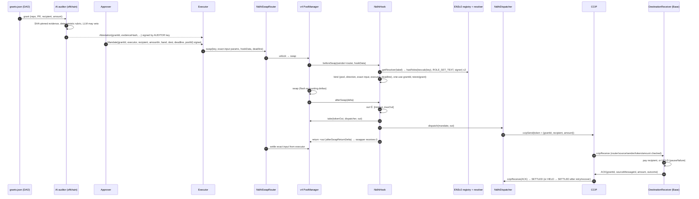

# Architecture

## Components

| Contract | Chain | Role |
|---|---|---|
| `NidhiHook` | Sepolia | v4 hook. `beforeSwap` is the firewall; `afterSwap` captures the output and dispatches it atomically. Bound to one pool, one router and minimal permissions (`0xC4`). |
| `NidhiSwapRouter` | Sepolia | Minimal unlock-callback router. The caller pays the exact input via allowance, and `msgSender()` exposes the initiator to the hook. |
| `NidhiDispatcher` | Sepolia | Grant ledger and CCIP endpoint. Sends the programmable token transfer and accepts the ACK. |
| `ENSv2Authority` | Sepolia | Resolves the DAO name to its resolver through the ENSv2 registry, then checks EAC roles. |
| `DestinationReceiver` | Base Sepolia | Defensive CCIP receiver: pays out or holds, recovers, and sends a decoupled ACK. |

## Grant lifecycle



Steps 5 to 17 happen in **one transaction on Sepolia**. If any check fails, nothing moves.

## Accounting detail (afterSwapReturnDelta)

For an exact-input swap, the unspecified currency is the output. The hook returns `+out` as its unspecified delta, so the PoolManager credits the hook with `out` and reduces the swapper's output by `out`, to zero. Inside `afterSwap`, the hook calls `take(tokenOut, dispatcher, out)`, which debits the hook by `out`. Its net delta is therefore 0 when the unlock closes. The router settles only the negative input delta. This mechanism is what makes "funds never rest in a human wallet" literally true.

## Ledger (source) and payout state (destination)

```
NidhiDispatcher:  NONE ─dispatch─▶ DISPATCHED ─ACK PAID─▶ SETTLED
                                       │                    ▲
                                       └─ACK HELD─▶ HELD ─ACK PAID / RECOVERED
DestinationReceiver: (unseen) ─receive─▶ PAID | HELD ─retryPayout─▶ PAID
                                                  └──recover(DAO)─▶ RECOVERED
```

Transitions only move forward; the invariant tests enforce this. A grant still `DISPATCHED` after `STUCK_AFTER` (6h) can be flagged with `flagStuck`. CCIP cannot be unwound, so recovery always happens on the destination: anyone can run CCIP manual execution, and the DAO can call `recover`.

## ENSv2 role model

- **The DAO owns `nidhi-dao.eth`.** Its resolver is a `PermissionedResolver` proxy created through the `VerifiableFactory`.
- **The DAO admin holds only `ROLE_SET_TEXT_ADMIN`.** It can delegate and revoke roles, but it cannot approve grants itself.
- **Approver role:** `grantSetterRoles(setText(name, "nidhi.role.approver", ""), approver)`, which writes `ROLE_SET_TEXT` on resource `keccak256("nidhi.role.approver")`.
- **Auditor role:** the same call with key `"nidhi.role.auditor"`.
- **The hook asks the registry for the resolver on every swap.** If the DAO moves its name to a new resolver, permissions follow automatically. If the name expires, every check fails closed.

The adapter matches the `PermissionedResolver` implementation deployed on Sepolia at `0x115eb53F…2b2C` (Sourcify exact match). The unreleased `main` branch of `ensdomains/contracts-v2` scopes resources by namehash instead. `ENSv2Authority` is the single place to change if the deployment is upgraded.

## AI auditor (off-chain, accountable but not trusted)

1. **Inputs are pinned:** repo, PR, merge commit SHA, head SHA, per-file blob SHAs, the full diff hash and the RFP hash.
2. **A deterministic rubric (`rubric.json`) decides pass/fail:** merged, approvals, no failed checks, path globs, size.
3. **The LLM review is advisory** (model `claude-opus-5-5`, structured JSON output). It can only veto, and it never sees or sets amounts. Current models reject `temperature`, so reproducibility comes from the rubric, not from sampling settings.
4. **`evidenceHash`** = `keccak256(abi.encode(inputsHash, rubricHash, promptHash, modelHash, outputHash))`. The approver signs this value inside the Mandate.
5. **`verify.ts`** recomputes everything reproducible from scratch, checks the auditor's signature, and checks the auditor's ENS role on-chain.

## v3 additions

### Safety rails (NidhiHook)
- **Daily cap:** `maxAmountInPerDay` is immutable. `spentPerDay[block.timestamp / 1 days]` is checked and incremented in `beforeSwap`; `remainingToday()` is a public view.
- **Guardian kill-switch:** `setPaused(bool)` is callable only by an account holding the ENS role `nidhi.role.guardian`. While paused, `beforeSwap` reverts first.
- **Cancellation:** `cancelGrant(grantId)` is callable by any ENS approver. It marks the grant used, so a signed mandate can never execute.
- **Batch:** `NidhiSwapRouter.swapBatch` runs N swaps inside one `unlock`. The transient grant slot hands over sequentially, each grant sends its own CCIP message, and the whole batch is all or nothing. Off-chain quoting gives grant *i* the marginal band `quote(prior + amount) − quote(prior)`.

### ENS-native payouts
```
Mandate.recipientLabelHash = keccak256("alice")            (signed by the approver)
GrantAuth.recipientLabel   = "alice"                        (hook checks keccak == signed hash)
ENSv2Authority.resolveGrantee("alice"):
  ETHRegistry.getSubregistry("nidhi-dao")      → UserRegistry (0x562F…C656)
  UserRegistry.getResolver("alice")            → grants resolver (0x0195…bd4A)
  resolver.resolve(dns("alice.nidhi-dao.eth"), addr(node, 0x80000000 | 84532))  → grantee on Base
hook requires mandate.recipient == resolved (≠ 0)
```
Every link fails closed to `address(0)`: no subregistry, an expired subname, a reverting resolver, a malformed record.

### Discovery from ENS
`nidhi-dao.eth` carries text records `nidhi.contract.{hook,dispatcher,router,authority,receiver,poolId,deployBlock}`. The dashboard (`docs/index.html`) and anyone else find the deployment from the name alone.

### Self-healing destination (Chainlink Automation)
`DestinationReceiver` keeps an exact queue of grants that need work: an ACK still owed (`ackPending`) or a payout `HELD`.
- `checkUpkeep` returns up to `MAX_BATCH` actionable ids. A HELD grant isn't actionable while payouts are paused.
- `performUpkeep` re-checks each id: it pays HELD grants to their original recipient, then ACKs, or retries owed ACKs. Stale ids are skipped, never reverted on.
- The upkeep is registered on Automation Registry 2.3 (Base Sepolia) by `script/09_RegisterUpkeep.s.sol`.

### AI jury
`offchain/src/llm/` holds the provider adapters: Groq and Cerebras (OpenAI-compatible), Gemini (`generateContent` + `responseSchema`), and optional Claude.
- Models are discovered from each provider's model list unless pinned by `*_MODEL`.
- Veto rule: at least `min(2, reviewed)` jurors must say "inconsistent".
- The sorted `provider:model` list is bound into `modelHash`, and every raw verdict into `outputHash`.
