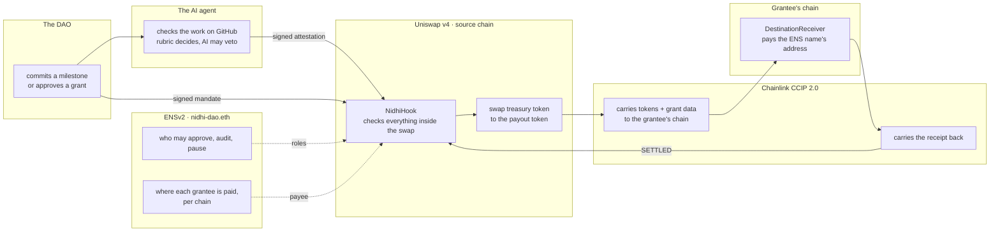
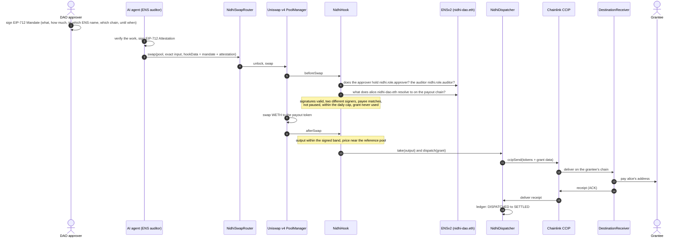
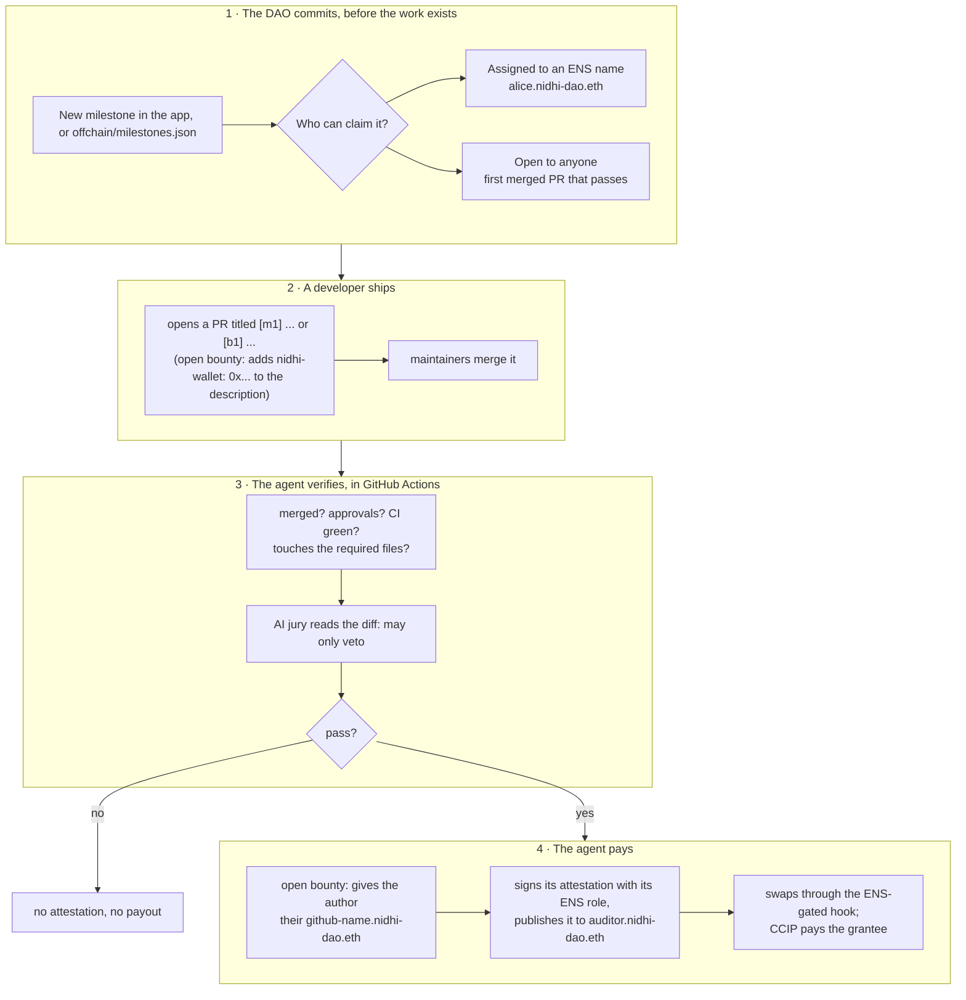

<div align="center">

# Nidhi

### Pay contributors on their own chain, and only after the work is checked.

**Nidhi** (निधि, *treasury* in Sanskrit) turns a DAO grant into one verifiable action. ENSv2 decides who may approve and who gets paid. A Uniswap v4 hook won't swap the treasury until every rule passes. Chainlink CCIP 2.0 lands the money on the contributor's chain in about 7 minutes and sends a receipt home.

**[Open the live app](https://neevmodh.github.io/nidhi/)** · [Verified contracts](#8-live-deployment-every-contract-verified) · [Live proof](#9-live-proof-real-transactions) · [Demo script](DEMO.md)

[Uniswap v4 deep dive](docs/architecture/02-uniswap-v4.md) · [ENSv2 deep dive](docs/architecture/01-ens.md) · [CCIP 2.0 deep dive](docs/architecture/03-chainlink-ccip.md) · [Milestone agent](docs/architecture/04-milestone-agent.md)

ETHGlobal Mumbai · **Build with Uniswap** · **Best Use of ENSv2** · **Best use of Chainlink CCIP 2.0**

</div>

---

## At a glance

| | |
|---|---|
| **Live app** | [neevmodh.github.io/nidhi](https://neevmodh.github.io/nidhi/): landing page, grants, milestones, ENS roles, all read live from the chains |
| **Fastest live payout** | **6 min 36 s**, Sepolia → Base, with CCIP 2.0 Faster-Than-Finality (was 15–25 min) |
| **Networks** | Ethereum Sepolia · Base Sepolia · Arbitrum Sepolia · Unichain Sepolia |
| **Contracts** | Every contract in use is **source-verified** on its explorer. The live product is [7 contracts](#the-live-product-7-verified-contracts). |
| **Autonomous payout** | A merged PR (`[m1]`) was verified and paid by the agent with no human in between, and **settled** on-chain |
| **Tests** | 137 Foundry tests (unit, fuzz, invariant), plus fork suites against live Sepolia |
| **Source** | [github.com/neevmodh/nidhi](https://github.com/neevmodh/nidhi) |

---

## Contents

1. [The problem](#1-the-problem)
2. [What Nidhi does, in one picture](#2-what-nidhi-does-in-one-picture)
3. [The three protocols and their jobs](#3-the-three-protocols-and-their-jobs)
4. [A grant, step by step](#4-a-grant-step-by-step)
5. [Paid in about 7 minutes: CCIP 2.0 Faster-Than-Finality](#5-paid-in-about-7-minutes-ccip-20-faster-than-finality)
6. [Milestones and open bounties: the agent checks the work and pays](#6-milestones-and-open-bounties-the-agent-checks-the-work-and-pays)
7. [Why the agent cannot misbehave](#7-why-the-agent-cannot-misbehave)
8. [Live deployment: every contract verified](#8-live-deployment-every-contract-verified)
9. [Live proof: real transactions](#9-live-proof-real-transactions)
10. [Prize tracks: what each asks for, and where it is](#10-prize-tracks-what-each-asks-for-and-where-it-is)
11. [The app](#11-the-app)
12. [Repository map](#12-repository-map)
13. [Run it yourself](#13-run-it-yourself)
14. [Tests and verification](#14-tests-and-verification)
15. [Honest limits](#15-honest-limits)

---

## 1. The problem

DAOs hand out a lot of money for work: grants, bounties, milestones. Paying one today means several separate steps, usually several separate multisig transactions:

1. someone decides the work is done;
2. someone swaps treasury tokens into what the grantee wants;
3. someone holds them, then bridges them to the grantee's chain;
4. someone checks later whether it arrived.

Nothing links the approval to the swap, the swap to the bridge, or the bridge to the payee. Each step is a chance to pay the wrong amount, the wrong person or the wrong chain, and nobody can prove afterwards that the money went exactly where the DAO decided. We call this the **blind send**.

**Nidhi makes the payout one atomic, verifiable action.** Authorisation, conversion and dispatch happen in a single source-chain transaction, or not at all. Every grant is tracked on-chain until the destination confirms it, and reaches `SETTLED` only when it has.

---

## 2. What Nidhi does, in one picture



---

## 3. The three protocols and their jobs

| Layer | Protocol | Job in Nidhi | If it says no |
|---|---|---|---|
| **Identity and permissions** | **ENSv2** | The DAO's name `nidhi-dao.eth` holds the approver, auditor and guardian roles through Enhanced Access Control. Grantees are subnames (`alice.nidhi-dao.eth`) that resolve to a different address on each chain. The AI agent is itself an ENS name. | No role, no grant. No ENS address on that chain, no payee. |
| **Execution and enforcement** | **Uniswap v4** | A custom hook runs inside the swap: two EIP-712 signatures, ENS roles, ENS payee, daily cap, price band, one use per grant. The swap output never reaches the caller: the hook takes it straight to the CCIP dispatcher. | The swap reverts. Nothing moves. |
| **Cross-chain settlement** | **Chainlink CCIP 2.0** | A programmable token transfer carries the exact amount plus the grant data to the grantee's chain, waiting 32 blocks instead of full finality. The receiver pays, then sends a receipt back. A relay pays chains with no direct lane. | The receiver holds the funds and anyone can retry. Nothing is lost. |

Each has its own deep dive with diagrams: **[Uniswap v4](docs/architecture/02-uniswap-v4.md)** · **[ENSv2](docs/architecture/01-ens.md)** · **[CCIP 2.0](docs/architecture/03-chainlink-ccip.md)**.

---

## 4. A grant, step by step



The ledger only moves forward: `DISPATCHED` to `SETTLED`, or `DISPATCHED` to `HELD` to `SETTLED` when a payout had to be held and was retried.

---

## 5. Paid in about 7 minutes: CCIP 2.0 Faster-Than-Finality

By default a CCIP message waits for its source block to be **final**, which takes about 15 minutes on Sepolia. CCIP 2.0 lets the sender ask for a fixed number of blocks instead, but only if the receiver agrees. Otherwise the message is accepted at send time and then fails on execution. Nidhi does both halves:

- **The dispatcher asks.** [`setRequestedFinality`](src/NidhiDispatcher.sol#L119) sets a block depth per destination lane. [`_buildMessage`](src/NidhiDispatcher.sol#L177) then sends `GenericExtraArgsV3` ([`ExtraArgsLib`](src/libraries/ExtraArgsLib.sol#L18)). With nothing set, the old V2 bytes go out unchanged.
- **The receiver agrees, but only for its own dispatcher.** [`getCCVsAndFinalityConfig`](src/DestinationReceiver.sol#L107) allows 20+ blocks for the known source dispatcher. Every other sender, and every unknown chain, still waits for full finality.
- **Lane minimums were probed live:** Sepolia → Base and Sepolia → Arbitrum accept 32 blocks or more, so that's what the dispatcher requests (about 6.4 minutes of Sepolia blocks).

**Measured on live testnet grants (6 Nov 2026):**

| Grant | Lane | Sent | Grantee paid | Time |
|---|---|---|---|---|
| `0xfd54…586d` | Sepolia → Base Sepolia | 08:31:00 UTC | 08:37:36 UTC | **6 min 36 s** |
| `0x7828…6a79` | Sepolia → Arbitrum Sepolia | 08:39:36 UTC | 08:46:51 UTC | **7 min 15 s** |

Before this, the same lanes took 15–25 minutes. The receipt leg (Base or Arbitrum back to Sepolia) still waits for full finality, because those lanes offer nothing else. The grantee already has the money at that point; `SETTLED` is the DAO's proof. Tests: [`FasterThanFinality.t.sol`](test/unit/FasterThanFinality.t.sol).

---

## 6. Milestones and open bounties: the agent checks the work and pays

Nidhi pays for work without anyone pressing "send".



- **Two kinds of milestone.**
  - *Assigned* grants pay one ENS name. That's how DAO grant programs work: a proposal is approved, then milestones pay that team.
  - *Open* bounties pay whoever delivers first, like open-source bounties.
  - Merging is the selection: only maintainers can merge.
- **Contributors get ENS identities.** The first time someone wins an open bounty, the agent registers `<github>.nidhi-dao.eth` for them, with:
  - their own resolver;
  - their wallet for the payout chain;
  - a `com.github` text record.

  Then it gives up its own roles on that resolver, so the contributor owns their name.
- **Creating milestones from the site.** A DAO member whose wallet holds the approver role on `nidhi-dao.eth` posts a milestone on-chain from the Milestones screen. The form checks the role live and quotes the payout with Uniswap's V4Quoter.

### How the work is checked

The agent ([`offchain/src/agent.ts`](offchain/src/agent.ts)) runs in GitHub Actions when a PR is merged, and every 15 minutes as a fallback.

1. **The rules were fixed before the work started.** The DAO's approver signs a hash of the milestone's text, repo, required files, approvals, amount and chain. On-chain milestones store it on the board. If the text shown to developers ever stops matching that hash, the agent refuses.
2. **Quick refusals:**
   - already paid, checked on every hook ever deployed, so nothing is paid twice;
   - expired;
   - cancelled;
   - signed for a different hook.
3. **The claiming PR:** of the **merged** PRs whose title carries the tag (`[m1]`, `[b2]`), the **first merged** wins.
4. **Evidence, pinned:** the agent fetches the PR, its changed files, reviews, CI results and diff, and hashes them (`inputsHash`) so anyone can re-run the decision ([`verify.ts`](offchain/src/verify.ts)).
5. **The rubric decides**, as plain code ([`evaluateRubric`](offchain/src/lib.ts)). Every rule must pass:

   | Rule | Passes when |
   |---|---|
   | `requireMerged` | the PR is merged |
   | `minApprovals` | it has the required number of approving reviews |
   | `requireNoFailedChecks` | no CI check failed (the agent's own run is ignored) |
   | `touches:<glob>` | at least one changed file matches the required path, e.g. `docs/**` |
   | `maxFilesChanged` | 60 files or fewer |

6. **The AI jury can only veto.** Groq (gpt-oss-120b) and Gemini read the diff against the milestone text. If enough of them say "inconsistent", the payout is blocked. They can never pass a failed rubric, choose an amount or choose a payee.
7. **The payee:**
   - an assigned milestone pays its ENS name;
   - an open bounty pays the PR author's `<github>.nidhi-dao.eth`, which is refused if that name belongs to a different GitHub user (no squatting).

   ENS must resolve the name on the payout chain, and the board must confirm the exact payout (`matches`).
8. **Sign, publish, pay:**
   - the agent signs an EIP-712 attestation with its ENS **auditor** role;
   - writes `<id>:pr<n>:<inputsHash>` to `auditor.nidhi-dao.eth`;
   - sends the swap.

   The hook then re-checks everything on-chain.

**On the frontend,** each milestone card shows a four-step timeline, each step read from its source:

| Step | Shows | Read from |
|---|---|---|
| DAO committed the milestone | spec hash, approver, time | `milestones.json` or the **NidhiBountyBoard** contract |
| PR #N merged / open | title, author, approvals, CI green / failed / running | GitHub |
| Agent verified the work | the auditor address and transaction | the hook's **`GrantAuthorized`** event |
| Payout | paid, then **Paid and settled**, with the grant timeline | the dispatcher's **`statusOf`** |

Full flow and code: **[docs/architecture/04-milestone-agent.md](docs/architecture/04-milestone-agent.md)**.

---

## 7. Why the agent cannot misbehave

The agent is automated, so the design assumes it could be buggy or compromised. Here is what it would still be unable to do.

| The agent tries to | What stops it |
|---|---|
| Pay more than committed, or another token | The approver's mandate (or the on-chain milestone) fixes the amount, token pair and pool; the hook refuses anything else. |
| Pay someone else | The payee must be exactly what the grantee's ENS name resolves to on that chain. For an assigned milestone the name itself is fixed; for an open one, the board requires an ENS subname and the agent can only register names for the PR's author. |
| Pay twice | Each milestone has one `grantId`; the hook marks it used. |
| Pay a milestone nobody committed to | Without the approver's signature, or a matching milestone on the board (which is itself an ENS approver), the hook rejects the swap. |
| Pay at a manipulated price | The output must sit inside the signed band; on mainnet the price must also match the deep Uniswap pool within 3% (StateView guard). |
| Drain the treasury quickly | A daily cap limits every grant together. The ENS guardian can pause everything in one transaction. |
| Keep paying after it is removed | Its role is an ENS permission. Revoking it on `nidhi-dao.eth` stops it on the next swap. |

The **deterministic rubric** decides pass or fail. **AI models** read the diff and can only veto. Every decision is pinned to commit and file SHAs, so anyone can re-run it (`offchain/src/verify.ts`).

---

## 8. Live deployment: every contract verified

Four testnets, wired along real CCIP lanes. The payout token on testnets is CCIP-BnM. Ownership is handed to the DAO admin `0x9f75…b9C7` (Ownable2Step).

**Every contract in use is source-verified** on its block explorer. Each link below opens the verified code. Older stacks were verified against the exact commit they were deployed from.

### The live product: 7 verified contracts

ENSv2 roles + CCIP 2.0 Faster-Than-Finality.

| # | Contract | Chain | Verified source | What it does |
|---|---|---|---|---|
| 1 | `NidhiHook` | Ethereum Sepolia | [`0x53d6E4a0…80c4`](https://sepolia.etherscan.io/address/0x53d6E4a020DBB0c7950D785B081D02DB3F5D80c4#code) | Uniswap v4 hook. Checks both signatures, the ENS roles, the daily cap and the price band inside the swap, then takes the whole output for delivery |
| 2 | `NidhiSwapRouter` | Ethereum Sepolia | [`0xAd97abe2…8990`](https://sepolia.etherscan.io/address/0xAd97abe2F1091E0d045A91E40f26AF09d5718990#code) | Sends the signed grant swap into the pool and tells the hook who the real executor is |
| 3 | `NidhiDispatcher` | Ethereum Sepolia | [`0x673a2374…6e6D`](https://sepolia.etherscan.io/address/0x673a23742E3Fd4a236A19776574c14D1e5866e6D#code) | Sends the CCIP programmable token transfer, asks for 32 blocks (Faster-Than-Finality) and keeps the grant ledger |
| 4 | `ENSv2Authority` | Ethereum Sepolia | [`0x92ceAa59…5600`](https://sepolia.etherscan.io/address/0x92ceAa59dfB8Ce4A85dCECFd26e50Ba58e375600#code) | Reads approver, auditor and guardian roles from `nidhi-dao.eth` and resolves grantee names per chain |
| 5 | `NidhiBountyBoard` | Ethereum Sepolia | [`0xb8308A2D…dC5`](https://sepolia.etherscan.io/address/0xb8308A2DE6d090AD263e5D5d5102C71109fb9dC5#code) | On-chain milestones and open bounties; itself an ENS approver (ERC-1271) |
| 6 | `DestinationReceiver` | Base Sepolia | [`0x48A03a48…49Ce`](https://sepolia.basescan.org/address/0x48A03a48F3B8a2AD7F83346b7Ee527773b6E49Ce#code) | Pays the grantee, holds and retries a failed payout, sends the receipt back, and accepts Faster-Than-Finality only from its own dispatcher |
| 7 | `DestinationReceiver` | Arbitrum Sepolia | [`0x3aEB7253…a7a4`](https://sepolia.arbiscan.io/address/0x3aEB7253A4543f12404C8c13C2D44B0E4D97a7a4#code) | The same, on Arbitrum |

Only the hook uses CREATE2: Uniswap v4 reads a hook's permissions from its address, so the salt is mined until the address ends in `…c4` (beforeSwap + afterSwap + afterSwapReturnDelta).

### Per-chain stacks (role registry)

| Chain | `NidhiHook` | `NidhiDispatcher` | `DestinationReceiver` | `RoleAuthority` |
|---|---|---|---|---|
| Ethereum Sepolia | [`0xa020A751…c0c4`](https://sepolia.etherscan.io/address/0xa020A75106A7a5094Fb0530692Ee8aaADe7fc0c4#code) | [`0x438E5Db9…5115`](https://sepolia.etherscan.io/address/0x438E5Db9667Ada9B2b892aC2bcAC4E3a5a725115#code) | [`0x4E5A6ce8…C690`](https://sepolia.etherscan.io/address/0x4E5A6ce89eaDE86be64f1Bb095aA3b45C371C690#code) | [`0xeBA6566B…15b9`](https://sepolia.etherscan.io/address/0xeBA6566Bee077966F9d28D6d230102e6D43D15b9#code) |
| Base Sepolia | [`0xB703D879…80c4`](https://sepolia.basescan.org/address/0xB703D879B1F3fE33184841B42bc61097133A80c4#code) | [`0xc7Bfda6A…31A2`](https://sepolia.basescan.org/address/0xc7Bfda6AC241f12fb21E491866d919A1B03431A2#code) | [`0x0c892F69…7958`](https://sepolia.basescan.org/address/0x0c892F6905C3C9b4Fb5dA628B3F8048e09107958#code) | [`0x8C507e44…13BE`](https://sepolia.basescan.org/address/0x8C507e4407466A2550E16EAe3a6BE8ABAa5C13BE#code) |
| Arbitrum Sepolia | [`0x56d56254…80c4`](https://sepolia.arbiscan.io/address/0x56d56254A518142375E9eA9a69f310aB8D7b80c4#code) | [`0xB2ab0955…D36A`](https://sepolia.arbiscan.io/address/0xB2ab0955a101802Bc9e2F1ec099Bd74Aed9bD36A#code) | [`0xd52365cA…D6B9`](https://sepolia.arbiscan.io/address/0xd52365cA8Fa5Cf07f3Bd9dFd64c024E455F4D6B9#code) | [`0x11252C99…0216`](https://sepolia.arbiscan.io/address/0x11252C994ccba7BE458D78C8901dAD6B5D1F0216#code) |
| Unichain Sepolia | [`0x2835f2af…C0c4`](https://sepolia.uniscan.xyz/address/0x2835f2af22486B547EE2E3F94805160b380bC0c4#code) | [`0xB2ab0955…D36A`](https://sepolia.uniscan.xyz/address/0xB2ab0955a101802Bc9e2F1ec099Bd74Aed9bD36A#code) | [`0xd52365cA…D6B9`](https://sepolia.uniscan.xyz/address/0xd52365cA8Fa5Cf07f3Bd9dFd64c024E455F4D6B9#code) | [`0x11252C99…0216`](https://sepolia.uniscan.xyz/address/0x11252C994ccba7BE458D78C8901dAD6B5D1F0216#code) |

Lanes: Sepolia ⇄ Base, Sepolia ⇄ Arbitrum, Sepolia ⇄ Unichain, Base ⇄ Arbitrum, Arbitrum ⇄ Unichain.

### Multi-hop route (CCIP, no direct lane)

When the grantee's chain has no direct lane from the DAO's chain (Base → Unichain), the swap still happens once on the source chain. The relay forwards the tokens and grant data over the next lane, then relays the receipt back.

| Contract | Chain | Address |
|---|---|---|
| Hop source stack: hook / dispatcher | Base Sepolia | [`0xFAc8F26e…80c4`](https://sepolia.basescan.org/address/0xFAc8F26eE3993C86001318E5D21c2D705a2A80c4#code) / [`0x0d8d8b23…8796`](https://sepolia.basescan.org/address/0x0d8d8b2382968820A7486E83A1f2d6C0C9068796#code) |
| `NidhiHopRelay` | Arbitrum Sepolia | [`0x4696Ff14…875c`](https://sepolia.arbiscan.io/address/0x4696Ff144E66AbD4458c89947bdb7Ea656b7875c#code) |
| Final `DestinationReceiver` | Unichain Sepolia | [`0x394A2229…ebe9`](https://sepolia.uniscan.xyz/address/0x394A222934a87edcBfc58d109Cb3a11Cb31Febe9#code) |

### Previous ENSv2 stack (v4), kept for the history of earlier grants (Sepolia)

| Contract | Address | Role |
|---|---|---|
| `NidhiHook` (ENS-gated) | [`0x88257DA3…80c4`](https://sepolia.etherscan.io/address/0x88257DA3a88Aaaf8b3EEF52112Bfb9C3596580c4#code) | The hook that paid milestone m1 |
| `NidhiDispatcher` | [`0x2bE281A8…A07b`](https://sepolia.etherscan.io/address/0x2bE281A806d754c2a7b5899a7effb649Fb72A07b#code) | Routes to its own receivers on [Base Sepolia](https://sepolia.basescan.org/address/0x9197993f0c9fc1B9920e9f1b81b4852334B2Cc83#code) and [Arbitrum Sepolia](https://sepolia.arbiscan.io/address/0xa08D0621872539A8b5c0DB986BDb7367833aA6cA#code) |
| `NidhiBountyBoard` | [`0xC4CDeeD4…2f2a`](https://sepolia.etherscan.io/address/0xC4CDeeD49580786f0262779472E3e63d95952f2a#code) | The first on-chain milestone board |

It shares the `ENSv2Authority` above. Every address is in `deployments/*.json`; chain data is in `chains/testnets.json` (generated and checked on-chain by `offchain/src/testnets.ts`).

### Mainnet: rehearsed, not deployed

`chains/registry.json` covers the 21 Uniswap v4 mainnets. Ten can send USDC by CCIP (50 lanes). The same Deploy / Wire / Handover scripts ran on forks of each, against the real PoolManager, PositionManager, V4Quoter, StateView, CCIP router and USDC:
- **Pass:** Ethereum, Base, Arbitrum, Polygon, Avalanche, HyperEVM and Monad.
- **Skipped:** Optimism, Unichain and Ink, because their CCIP RMN was cursed when checked.

Going live needs a funded deployer (`node offchain/src/preflight.ts` prints exact amounts).

---

## 9. Live proof: real transactions

| What happened | Evidence |
|---|---|
| **Faster-Than-Finality, Sepolia → Base, paid in 6 min 36 s:** the v5 dispatcher requested 32 blocks, and the Base receiver paid `alice.nidhi-dao.eth` | [swap](https://sepolia.etherscan.io/tx/0x893ecdd4f989fea206040409ed7f6e97602f2120a0d27f054619f3b2b1170099) · [CCIP](https://ccip.chain.link/msg/0xa9a349d1a6abc797cb5de273498cc17bf6acc49497210b55f4329e75b39be27d) · [payout](https://sepolia.basescan.org/tx/0x6d2797db6b4bc9a72df91f6539f2979bbf7b097fde26f4451353ec6585bb13f1) |
| **Faster-Than-Finality, Sepolia → Arbitrum, paid in 7 min 15 s** | [swap](https://sepolia.etherscan.io/tx/0xee091d4a8882525019d5e62a07f317783335217e73a1ce6308468b92e9ca1043) · [CCIP](https://ccip.chain.link/msg/0x743c6c3e016a2fcd992ee33ee273e5d9df91a3fc72b53136c363ce38ec96e198) · [payout](https://sepolia.arbiscan.io/tx/0xd25576e5f1810c7326820939c999b666c2b1389131d99997c6516ceb62f3f29a) |
| **The agent paid a milestone by itself.** PR #3 `[m1]` was merged. The agent (GitHub Actions) checked every rule, signed with its ENS auditor role, published to `auditor.nidhi-dao.eth`, and swapped through the ENS-gated hook to pay `alice.nidhi-dao.eth` 0.2853 CCIP-BnM on Base Sepolia | [publish](https://sepolia.etherscan.io/tx/0x5d65178ca1498a1eb23e2efb15039460bd2b1621c31d26aa96fd19da048ad080) · [payout swap](https://sepolia.etherscan.io/tx/0xb8f24e16f4fe2bfa71d205e3ac48d13541a7a42ff0d35abbd8b5a9119408cfaf) · [CCIP](https://ccip.chain.link/msg/0xd5f29fca4fe48876bf65b997799675a2dc14090814ca0fb620c7452d4ed70f0c) · [paid on Base](https://sepolia.basescan.org/tx/0x28af81773cd873c96c84bce19179c0f7ed2d3751b2b126f9c198373cb48396f9) · [PR #3](https://github.com/neevmodh/nidhi/pull/3) |
| **A held receipt, retried, then settled.** m1's receipt first failed because the Base receiver's fee reserve was too low; the payout stayed made. After a top-up, anyone could call `retryAck`, and the grant reached `SETTLED` | [retryAck](https://sepolia.basescan.org/tx/0x22a1a202fba67ae0eabdd8ff914c10dc584df16bbaf262c6e15b7481016bf6fe) · [receipt](https://ccip.chain.link/msg/0x85326f098659e2e6893224e72ab664d8ad813e0baf52481f1f246fd884efc842) |
| **ENSv2-gated grant settled:** roles read from `nidhi-dao.eth`, payee `alice.nidhi-dao.eth` resolved for Base Sepolia, swapped, bridged, paid, receipt back | [swap](https://sepolia.etherscan.io/tx/0x696887ae1880740414a2746ad6c2e764f248781ecf26eaaaabcda723088fe3e0) · [CCIP](https://ccip.chain.link/msg/0xe5721859a03a43697d7ce3b2c5fcd8a73a5d5c9ed881ab34db33edb4ccba17a2) |
| **Multi-hop CCIP settled:** Base Sepolia → Unichain Sepolia (no direct lane) through the relay on Arbitrum Sepolia, paid on Unichain, receipt relayed back | [swap](https://sepolia.basescan.org/tx/0x47c75cf9e20812733516d2a5642f39111a476efc2b8af1f569dbb6480cc14168) · [relay forward](https://sepolia.arbiscan.io/tx/0xeab38417c58e402c2d7e9c5f3491d0adbb1217bb44ebef1aa2e4ed11c1c8977f) |
| **Base Sepolia → Arbitrum Sepolia settled** | [swap](https://sepolia.basescan.org/tx/0xdd2b11a77fa318b95c812589f07211ad71e0fbc0e174fc6b78487a1bc1b328a0) · [CCIP](https://ccip.chain.link/msg/0x60433b4f9215063950bde9736f3618766fdbbdde7f43e895dba724fc3d2faf7e) · [payout](https://sepolia.arbiscan.io/tx/0x74c5f98f165389683c3201ce3b283e63e9965eaed03c5faed8d389e8f6d3c21c) |
| **Sepolia → Base Sepolia settled** | [swap](https://sepolia.etherscan.io/tx/0xf2d1a270524c098410037c03720714fbe049fba9ba880b1463c0b3fd53f9207a) · [CCIP](https://ccip.chain.link/msg/0x9c3ddac23e4af71f197c9b71b36b36f11fdbc8068e25c8c6d36468d65ff1fdfa) · [payout](https://sepolia.basescan.org/tx/0xf3e05ffddcbd9e86ca12ae3c84783a1f1482824613f4ed6cbdf9449e1d628294) |
| **The app's own signing code, on-chain:** a grant built, quoted (V4Quoter) and signed with `ui/src/lib/mandate.ts`, settled | [swap](https://sepolia.basescan.org/tx/0x23c79346238efea4b006f4a6a9533d26a393609630783a38fb89c84170f76c74) |
| **The AI auditor is an ENS agent:** it published its attestation to the one record it may write | [`setText`](https://sepolia.etherscan.io/tx/0x9956a77cc937c7c33839c7882fa8de598bf8f5c296e1ad88d44ade924586c85c) |
| **`bob.nidhi-dao.eth` owns his resolver:** the DAO key set the first records, then gave up its role | [resolver](https://sepolia.etherscan.io/tx/0x4fa99ec2271f4622b63b77186131c70612912f524517d6c2ca81bb5fc01be10d) · [renounce](https://sepolia.etherscan.io/tx/0xe39eb0a174890df7e9771519cf1c9e619a58128a792a5f2cbf05c779bc570e73) |
| **`carol.nidhi-dao.eth` has an expiring name** (her grant period): after it, ENS stops resolving her and the hook refuses to pay | [register](https://sepolia.etherscan.io/tx/0x5de4f4a47b52aad6088d5ad189ff0911caf60106f91fbf3905c7223998a50953) |
| **Open bounty `b1` posted on-chain** by an ENS approver | [post](https://sepolia.etherscan.io/tx/0xa94dda4e4d76a77855a5d88bfb8239f874ae28805d73256d2dc425e39e983038) |

Earlier (v3, retired): guardian pause, ENS role revocation, mandate cancellation and batch payouts were proven live on the v3 deployment; the scripts are archived in [`legacy/sepolia-v3/`](legacy/sepolia-v3/).

---

## 10. Prize tracks: what each asks for, and where it is

### Build with Uniswap

| They ask for | Nidhi |
|---|---|
| A new v4 hook | `NidhiHook`: a mandate-gated hook that takes its own swap output with `afterSwapReturnDelta`, live on four testnets. [`_beforeSwap` L242](src/NidhiHook.sol#L242) · [`_afterSwap` L357](src/NidhiHook.sol#L357) · [`getHookPermissions` L172](src/NidhiHook.sol#L172) |
| Uniswap AMM v4 | Real PoolManagers; DAO liquidity as a PositionManager NFT through Permit2 ([`_mintUsdcOnly`](script/mainnet/Deploy.s.sol)); exact quotes from V4Quoter, which the hook lets through; an on-chain price guard from StateView ([`_checkReferencePrice` L321](src/NidhiHook.sol#L321)) |
| The Uniswap API | Trading API for the auditor's USD valuation and treasury funding ([`tradingApi.ts`](offchain/src/uniswap/tradingApi.ts), [`treasury.ts`](offchain/src/treasury.ts)) |
| Tooling for the ecosystem | A generated, on-chain-checked registry of every v4 chain ([`registry.ts`](offchain/src/registry.ts), [`testnets.ts`](offchain/src/testnets.ts)) and fork rehearsals ([`rehearse-all.sh`](offchain/rehearse-all.sh)) |
| `FEEDBACK.md` | [FEEDBACK.md](FEEDBACK.md) |

### Best Use of ENSv2

| They ask for | Nidhi |
|---|---|
| ENSv2 central, not cosmetic | On the ENS-gated stack the DAO's name **is** the authority: no ENS role, no grant; no ENS address, no payee. [`isAuthorized` L94](src/ENSv2Authority.sol#L94) · [`resolveGrantee` L105](src/ENSv2Authority.sol#L105) |
| Enhanced Access Control to delegate specific rights | Each role is permission to set one text record on `nidhi-dao.eth`. The auditor agent may set only `nidhi.attestation`. The bounty board contract holds the approver role. |
| Your own subname registry | A UserRegistry for `*.nidhi-dao.eth`: grantees and contributors are subnames ([`EnsSetup.s.sol`](script/ens/EnsSetup.s.sol), [`bounty.ts`](offchain/src/bounty.ts)) |
| Subnames with their own Permissioned Resolver | `bob.nidhi-dao.eth` and every bounty winner own their resolver; the DAO renounces its roles on it |
| Expiring / revocable subnames | `carol.nidhi-dao.eth` expires with her grant period; a revoked role stops a signer on the next swap |
| Bonus: AI agents as namespaces | `auditor.nidhi-dao.eth` publishes each signed verdict to its own record |
| Functional demo, no hard-coded values | The app's ENS and Milestones screens read roles, resolvers, per-chain addresses, expiry and the agent's record live |

### Best use of Chainlink CCIP 2.0

| They ask for | Nidhi |
|---|---|
| CCIP inside smart contracts, changing state | A programmable token transfer pays the grantee; the receipt moves the source ledger to `SETTLED`. [`dispatch` L133](src/NidhiDispatcher.sol#L133) · [ACK `_ccipReceive` L195](src/NidhiDispatcher.sol#L195) |
| CCIP 2.0 features | **Faster-Than-Finality:** per-lane block depth with `GenericExtraArgsV3` ([`setRequestedFinality` L119](src/NidhiDispatcher.sol#L119), [`_buildMessage` L177](src/NidhiDispatcher.sol#L177)), and receiver opt-in through `getCCVsAndFinalityConfig` ([L107](src/DestinationReceiver.sol#L107)). Measured: 6 min 36 s to Base, 7 min 15 s to Arbitrum |
| Token transfers and arbitrary messaging | Both, in both directions, over five live lanes between four testnets |
| **Multi-hop: "send from A to B without worrying if the lane exists"** | [`NidhiHopRelay`](src/NidhiHopRelay.sol) forwards the grant over the next lane and relays the receipt back. Live: Base Sepolia → Arbitrum Sepolia → Unichain Sepolia, settled |
| Liquidity across multiple chains | A hooked v4 pool on every chain |
| CCIP Local Simulator | Used across the Foundry tests, including the two-hop relay ([`HopRelay.t.sol`](test/unit/HopRelay.t.sol)) |
| Encouraged: Automation | The receiver's held-payout and receipt queue implements `checkUpkeep` / `performUpkeep` ([L290](src/DestinationReceiver.sol#L290)); not registered on testnet (needs LINK) |

---

## 11. The app

**[neevmodh.github.io/nidhi](https://neevmodh.github.io/nidhi/)** is a static site (React, Vite, viem/wagmi) that reads the chains directly. Nothing is pre-recorded and there is no server.

**The landing page** opens first. It explains Nidhi in one scroll:
- a live connection from `nidhi-dao.eth` through the Uniswap v4 hook and Chainlink CCIP to `alice.nidhi-dao.eth`;
- three protocol slides;
- a real-work scene;
- one grant that lights up step by step as you scroll: commit → grant → check → swap → bridge → paid;
- a live count of settled grants.

| Screen | Shows |
|---|---|
| **Overview** | Cap left today, CCIP fee reserve, routes, health (paused, RMN curse, queue, ownership) |
| **Milestones** | Each milestone's four steps: the DAO's commitment, the PR's GitHub status, the agent's on-chain verification, the payout. **New milestone** button for approvers |
| **Grants** | Every grant from every stack, with a timeline linking each transaction and the CCIP explorer |
| **New grant** | Name the grantee, chain and amount; the approver and a separate auditor sign; the executor sends |
| **Network** | Live lanes, RMN status and fee reserves; the 21-chain mainnet registry |
| **Pool** | The hooked pool's price from StateView, the DAO's LP NFT, the guard |
| **Roles** | Who holds each role; grantee addresses |
| **ENS** | `nidhi-dao.eth` live: roles, subnames per chain, bob's own resolver, carol's countdown, the agent's record |

**Design:**
- a light theme (white and ivory, honey accent), with a dark mode on the toggle;
- official Uniswap, Chainlink, ENS and chain logos.

**Performance:** a shared incremental log cache and a build-time snapshot keep screens fast (a grant timeline loads in under 3 seconds), while statuses, payouts, roles and ENS records stay live reads.

**Design rules are enforced in CI** (`ui/scripts/check-design.mjs`): no emoji, no violet, no banned fonts. Brand: [`docs/brand.md`](docs/brand.md).

---

## 12. Repository map

```
src/                        Solidity (Foundry, 0.8.26)
  NidhiHook.sol             the Uniswap v4 hook: every check, then capture and dispatch
  NidhiSwapRouter.sol       trusted router: exposes the real initiator to the hook
  NidhiDispatcher.sol       source-chain ledger and CCIP sender (Faster-Than-Finality); receives receipts
  DestinationReceiver.sol   pays the grantee; holds and retries on failure; FTF opt-in; Automation queue
  NidhiHopRelay.sol         multi-hop CCIP relay for chains without a direct lane
  NidhiBountyBoard.sol      on-chain milestones; an ERC-1271 approver
  ENSv2Authority.sol        roles and payees from ENSv2
  RoleAuthority.sol         the same interface as a DAO-owned role registry
  libraries/                Mandate (EIP-712), ExtraArgsLib (CCIP V2/V3 args), AckLib (receipts)
script/
  mainnet/                  Deploy, Wire, Handover, LiveGrant (registry-driven, any chain)
  ens/                      ENS setup, ENS-stack routes, bounty board setup
  hop/                      multi-hop route
offchain/src/
  agent.ts                  the milestone agent (GitHub Actions)
  milestone.ts, bounty.ts   committing milestones; on-chain milestones and ENS contributor names
  audit.ts, verify.ts       AI auditor and independent re-verification
  registry.ts, testnets.ts  chain registries checked on-chain
ui/                         the app (landing page + product)
chains/, deployments/       chain data and every deployed address
docs/architecture/          the deep dives
```

---

## 13. Run it yourself

```bash
# prerequisites: Foundry, Node >= 22.18; copy .env.example to .env and fill in keys
git clone --recursive https://github.com/neevmodh/nidhi && cd nidhi
forge build && forge test

# the app, reading the live deployment
cd ui && npm ci && npm run dev

# the agent, once, without sending anything
cd offchain && npm ci && node src/agent.ts --dry-run

# commit a milestone (DAO approver) and post an open bounty
node src/milestone.ts commit m1
node src/post-bounty.ts '{"title":"...","body":"...","repo":"neevmodh/nidhi","payTo":84532,"amountEth":"0.0003","paths":["docs/**"],"approvals":0,"days":14}'

# deploy a stack on any registered chain (testnets: REGISTRY=chains/testnets.json)
forge script script/mainnet/Deploy.s.sol   --rpc-url <chain> --broadcast --slow
forge script script/mainnet/Wire.s.sol     --rpc-url <chain> --broadcast --slow
forge script script/mainnet/Handover.s.sol --rpc-url <chain> --broadcast --slow
```

Every deployment was rehearsed on anvil forks first.

---

## 14. Tests and verification

```bash
forge test                  # unit, fuzz and invariant suites; the fork suites also run with SEPOLIA_RPC_URL set
```

**137 tests pass**, including:

| Suite | Proves |
|---|---|
| `NidhiFlow` (39) | The full grant with receipt; every firewall rejection; 7702 and ERC-1271 signers; held, recovered and retried payouts |
| `BountyBoard` (9) | Open and assigned milestones through the real hook; tampering, cancellation, expiry, non-approvers, double payment and a revoked board all refused |
| `HopRelay` (7) | Two-hop settlement, held-then-settled through the relay, forged receipts and unknown senders refused |
| `FasterThanFinality` (7) | V3 extra args only when a depth is set; per-lane, owner-only finality; receivers accept FTF only from their own dispatcher; a full grant settles with FTF |
| `MultiChain`, `V3Features`, `EdgeCases` | Add-only routing, the price guard, RoleAuthority, daily cap, guardian, ENS fail-closed cases |
| `NidhiInvariant` | No funds rest in any contract; value is conserved; the cap is never exceeded; the receiver queue is exact |
| `LiveSepolia` (fork) | The real ENSv2 contracts and the real v4 PoolManager on a Sepolia fork |

CI runs formatting, the build, all tests, a gas snapshot and an independent re-verification of a committed audit. Every contract in use is source-verified on Etherscan, Basescan, Arbiscan and Uniscan, and submitted to Sourcify.

---

## 15. Honest limits

- **Testnets only.** Mainnet is rehearsed on forks of every eligible chain but not deployed; it needs funding.
- **ENSv2 is on Sepolia.** The ENS-gated stack and the milestone board live on Sepolia; other chains use the same hook with `RoleAuthority`.
- **Chainlink Automation** is implemented in the receiver but not registered on testnet (it needs LINK). **Data Feeds, CRE and VRF** are not used.
- **The agent's keys live in GitHub Actions secrets** (testnet keys). Its power is bounded by the hook, the board, the cap, the guardian and ENS revocation, as described in section 7.
- **Receipts still wait for finality.** Faster-Than-Finality speeds up the outbound leg (6–7 minutes measured). Receipts from Base and Arbitrum still wait for full finality, because those lanes allow nothing else, so `SETTLED` arrives about 20–40 minutes after sending. Grants sourced from Base or Arbitrum wait for full finality both ways.
- **Fee reserves need watching.** The dispatcher pays each grant's CCIP fee, and each receiver pays its receipt. If a reserve runs low, a grant can't be sent, or a receipt is held until someone tops it up and calls `retryAck`. The payout itself is never undone.
- **The very first hook (v3, retired)** is the one deployed contract not source-verified: it was deployed from uncommitted code. Nothing uses it.

More detail: [ARCHITECTURE.md](ARCHITECTURE.md) · [SECURITY.md](SECURITY.md) · [FEEDBACK.md](FEEDBACK.md) · [DEMO.md](DEMO.md)
