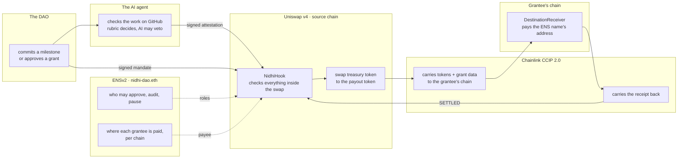
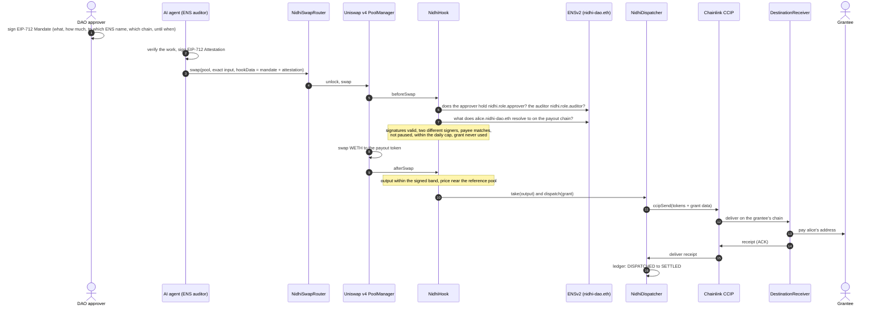
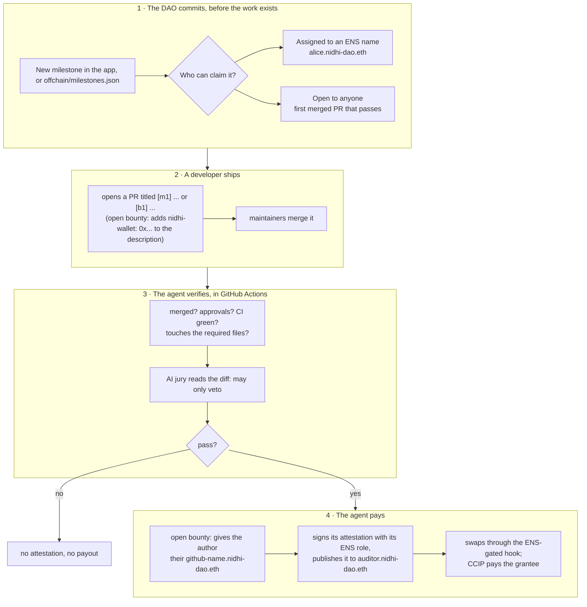

<div align="center">

# Nidhi

**DAO grants and open-source bounties, paid across chains by an AI agent that cannot pay anything the DAO did not commit to.**

A Uniswap v4 hook enforces the grant · ENSv2 decides who is allowed and who is paid · Chainlink CCIP 2.0 settles it on the grantee's chain

[Live app](https://neevmodh.github.io/nidhi/) · [Uniswap v4 deep dive](docs/architecture/02-uniswap-v4.md) · [ENSv2 deep dive](docs/architecture/01-ens.md) · [CCIP 2.0 deep dive](docs/architecture/03-chainlink-ccip.md) · [Milestone agent](docs/architecture/04-milestone-agent.md) · [Demo script](DEMO.md)

ETHGlobal Mumbai · tracks: **Build with Uniswap** · **Best Use of ENSv2** · **Best use of Chainlink CCIP 2.0**

</div>

---

## Contents

1. [The problem](#1-the-problem)
2. [What Nidhi does, in one picture](#2-what-nidhi-does-in-one-picture)
3. [The three protocols and their jobs](#3-the-three-protocols-and-their-jobs)
4. [A grant, step by step](#4-a-grant-step-by-step)
5. [Milestones and open bounties: the agent pays](#5-milestones-and-open-bounties-the-agent-pays)
6. [Why the agent cannot misbehave](#6-why-the-agent-cannot-misbehave)
7. [Live deployment](#7-live-deployment)
8. [Live proof: real transactions](#8-live-proof-real-transactions)
9. [Prize tracks: what each asks for, and where it is](#9-prize-tracks-what-each-asks-for-and-where-it-is)
10. [The app](#10-the-app)
11. [Repository map](#11-repository-map)
12. [Run it yourself](#12-run-it-yourself)
13. [Tests and verification](#13-tests-and-verification)
14. [Honest limits](#14-honest-limits)

---

## 1. The problem

A DAO paying a grant today does several separate things, usually by several separate multisig transactions:

1. someone decides the work is done;
2. someone swaps treasury tokens into what the grantee wants;
3. someone holds them, then bridges them to the grantee's chain;
4. someone checks later whether it arrived.

Nothing links the approval to the swap, the swap to the bridge, or the bridge to the payee. Each step is a chance to pay the wrong amount, the wrong person or the wrong chain, and nobody can prove afterwards that the money went exactly where the DAO decided. We call this the **blind send**.

**Nidhi makes the payout one atomic, verifiable action.** Authorisation, conversion and dispatch happen in a single source-chain transaction, or not at all. Every grant is tracked on-chain until the destination confirms it, and reaches `SETTLED` only when it has.

---

## 2. What Nidhi does, in one picture



---

## 3. The three protocols and their jobs

| Layer | Protocol | Job in Nidhi | If it says no |
|---|---|---|---|
| **Identity and permissions** | **ENSv2** | The DAO's name `nidhi-dao.eth` holds the approver, auditor and guardian roles through Enhanced Access Control. Grantees are subnames (`alice.nidhi-dao.eth`) that resolve to a different address on each chain. The AI agent is itself an ENS name. | No role, no grant. No ENS address on that chain, no payee. |
| **Execution and enforcement** | **Uniswap v4** | A custom hook runs inside the swap: two EIP-712 signatures, ENS roles, ENS payee, daily cap, price band, one use per grant. The swap output never reaches the caller: the hook takes it straight to the CCIP dispatcher. | The swap reverts. Nothing moves. |
| **Cross-chain settlement** | **Chainlink CCIP 2.0** | A programmable token transfer carries the exact amount plus the grant data to the grantee's chain. The receiver pays, then sends a receipt back. A relay pays chains with no direct lane. | The receiver holds the funds and anyone can retry. Nothing is lost. |

Each has its own deep dive with diagrams: **[Uniswap v4](docs/architecture/02-uniswap-v4.md)** · **[ENSv2](docs/architecture/01-ens.md)** · **[CCIP 2.0](docs/architecture/03-chainlink-ccip.md)**.

---

## 4. A grant, step by step



The ledger only moves forward: `DISPATCHED` to `SETTLED`, or `DISPATCHED` to `HELD` to `SETTLED` when a payout had to be held and was retried.

---

## 5. Milestones and open bounties: the agent pays

Nidhi pays for work without anyone pressing "send".



- **Two kinds of milestone.** *Assigned* grants pay one ENS name (how DAO grant programs work: a proposal is approved, then milestones pay that team). *Open* bounties pay whoever delivers first (how open-source bounties work). Merging is the selection: only maintainers can merge.
- **Contributors get ENS identities.** The first time someone wins an open bounty, the agent registers `<github>.nidhi-dao.eth` for them: their own resolver, their wallet for the payout chain, and a `com.github` text record. Then it gives up its own roles on that resolver, so the contributor owns their name.
- **Creating milestones from the site.** A DAO member whose wallet holds the approver role on `nidhi-dao.eth` posts a milestone on-chain from the Milestones screen. The form checks the role live and quotes the payout with Uniswap's V4Quoter.

Full flow and code: **[docs/architecture/04-milestone-agent.md](docs/architecture/04-milestone-agent.md)**.

---

## 6. Why the agent cannot misbehave

The agent is automated, so the design assumes it could be buggy or compromised. Here is what it would still be unable to do.

| The agent tries to | What stops it |
|---|---|
| Pay more than committed, or another token | The approver's mandate (or the on-chain milestone) fixes the amount, token pair and pool; the hook refuses anything else. |
| Pay someone else | The payee must be exactly what the grantee's ENS name resolves to on that chain. For an assigned milestone the name itself is fixed; for an open one, the board requires an ENS subname and the agent can only register names for the PR's author. |
| Pay twice | Each milestone has one `grantId`; the hook marks it used. |
| Pay a milestone nobody committed to | Without the approver's signature, or a matching milestone on the board (which is itself an ENS approver), the hook rejects the swap. |
| Pay at a manipulated price | The output must sit inside the signed band; on mainnet the price must also match the deep Uniswap pool within 3% (StateView guard). |
| Drain the treasury quickly | A daily cap limits every grant together. The ENS guardian can pause everything in one transaction. |
| Keep paying after it is removed | Its role is an ENS permission. Revoking it on `nidhi-dao.eth` stops it on the next swap. |

The **deterministic rubric** decides pass or fail. **AI models** (Groq, Gemini, others) read the diff and can only veto. Every decision is pinned to commit and file SHAs, so anyone can re-run it (`offchain/src/verify.ts`).

---

## 7. Live deployment

Four testnets, each running the full stack (hook, router, dispatcher, receiver), wired along real CCIP lanes. The payout token on testnets is CCIP-BnM. Ownership is handed to the DAO admin `0x9f75…b9C7` (Ownable2Step).

### Main stacks (role registry)

| Chain | `NidhiHook` | `NidhiDispatcher` | `DestinationReceiver` | `RoleAuthority` |
|---|---|---|---|---|
| Ethereum Sepolia | [`0xa020A751…c0c4`](https://sepolia.etherscan.io/address/0xa020A75106A7a5094Fb0530692Ee8aaADe7fc0c4) | [`0x438E5Db9…5115`](https://sepolia.etherscan.io/address/0x438E5Db9667Ada9B2b892aC2bcAC4E3a5a725115) | [`0x4E5A6ce8…C690`](https://sepolia.etherscan.io/address/0x4E5A6ce89eaDE86be64f1Bb095aA3b45C371C690) | [`0xeBA6566B…15b9`](https://sepolia.etherscan.io/address/0xeBA6566Bee077966F9d28D6d230102e6D43D15b9) |
| Base Sepolia | [`0xB703D879…80c4`](https://sepolia.basescan.org/address/0xB703D879B1F3fE33184841B42bc61097133A80c4) | [`0xc7Bfda6A…31A2`](https://sepolia.basescan.org/address/0xc7Bfda6AC241f12fb21E491866d919A1B03431A2) | [`0x0c892F69…7958`](https://sepolia.basescan.org/address/0x0c892F6905C3C9b4Fb5dA628B3F8048e09107958) | [`0x8C507e44…13BE`](https://sepolia.basescan.org/address/0x8C507e4407466A2550E16EAe3a6BE8ABAa5C13BE) |
| Arbitrum Sepolia | [`0x56d56254…80c4`](https://sepolia.arbiscan.io/address/0x56d56254A518142375E9eA9a69f310aB8D7b80c4) | [`0xB2ab0955…D36A`](https://sepolia.arbiscan.io/address/0xB2ab0955a101802Bc9e2F1ec099Bd74Aed9bD36A) | [`0xd52365cA…D6B9`](https://sepolia.arbiscan.io/address/0xd52365cA8Fa5Cf07f3Bd9dFd64c024E455F4D6B9) | [`0x11252C99…0216`](https://sepolia.arbiscan.io/address/0x11252C994ccba7BE458D78C8901dAD6B5D1F0216) |
| Unichain Sepolia | [`0x2835f2af…C0c4`](https://unichain-sepolia.blockscout.com/address/0x2835f2af22486B547EE2E3F94805160b380bC0c4) | [`0xB2ab0955…D36A`](https://unichain-sepolia.blockscout.com/address/0xB2ab0955a101802Bc9e2F1ec099Bd74Aed9bD36A) | [`0xd52365cA…D6B9`](https://unichain-sepolia.blockscout.com/address/0xd52365cA8Fa5Cf07f3Bd9dFd64c024E455F4D6B9) | [`0x11252C99…0216`](https://unichain-sepolia.blockscout.com/address/0x11252C994ccba7BE458D78C8901dAD6B5D1F0216) |

Lanes: Sepolia ⇄ Base, Sepolia ⇄ Arbitrum, Sepolia ⇄ Unichain, Base ⇄ Arbitrum, Arbitrum ⇄ Unichain.

### ENSv2-gated stack and the milestone board (Sepolia)

| Contract | Address | Role |
|---|---|---|
| `ENSv2Authority` | [`0x92ceAa59…5600`](https://sepolia.etherscan.io/address/0x92ceAa59dfB8Ce4A85dCECFd26e50Ba58e375600) | Reads roles and grantees from `nidhi-dao.eth` |
| `NidhiHook` (ENS-gated) | [`0x88257DA3…80c4`](https://sepolia.etherscan.io/address/0x88257DA3a88Aaaf8b3EEF52112Bfb9C3596580c4) | The hook the agent pays through |
| `NidhiDispatcher` | [`0x2bE281A8…A07b`](https://sepolia.etherscan.io/address/0x2bE281A806d754c2a7b5899a7effb649Fb72A07b) | Routes to its own receivers on [Base Sepolia](https://sepolia.basescan.org/address/0x9197993f0c9fc1B9920e9f1b81b4852334B2Cc83) and [Arbitrum Sepolia](https://sepolia.arbiscan.io/address/0xa08D0621872539A8b5c0DB986BDb7367833aA6cA) |
| `NidhiBountyBoard` | [`0xC4CDeeD4…2f2a`](https://sepolia.etherscan.io/address/0xC4CDeeD49580786f0262779472E3e63d95952f2a) | On-chain milestones; itself an ENS approver (ERC-1271) |

### Multi-hop route (CCIP, no direct lane)

| Contract | Chain | Address |
|---|---|---|
| Hop source stack: hook / dispatcher | Base Sepolia | [`0xFAc8F26e…80c4`](https://sepolia.basescan.org/address/0xFAc8F26eE3993C86001318E5D21c2D705a2A80c4) / [`0x0d8d8b23…8796`](https://sepolia.basescan.org/address/0x0d8d8b2382968820A7486E83A1f2d6C0C9068796) |
| `NidhiHopRelay` | Arbitrum Sepolia | [`0x4696Ff14…875c`](https://sepolia.arbiscan.io/address/0x4696Ff144E66AbD4458c89947bdb7Ea656b7875c) |
| Final `DestinationReceiver` | Unichain Sepolia | [`0x394A2229…ebe9`](https://unichain-sepolia.blockscout.com/address/0x394A222934a87edcBfc58d109Cb3a11Cb31Febe9) |

Every address is in `deployments/*.json`; chain data in `chains/testnets.json` (generated and checked on-chain by `offchain/src/testnets.ts`).

### Mainnet: rehearsed, not deployed

`chains/registry.json` covers the 21 Uniswap v4 mainnets. Ten can send USDC by CCIP (50 lanes). The same Deploy / Wire / Handover scripts ran on forks of each against the real PoolManager, PositionManager, V4Quoter, StateView, CCIP router and USDC: Ethereum, Base, Arbitrum, Polygon, Avalanche, HyperEVM and Monad pass; Optimism, Unichain and Ink were skipped because their CCIP RMN was cursed when checked. Going live needs a funded deployer (`node offchain/src/preflight.ts` prints exact amounts).

---

## 8. Live proof: real transactions

| What happened | Evidence |
|---|---|
| **The agent paid a milestone by itself.** PR #3 `[m1]` was merged; the agent (GitHub Actions) checked every rule, signed with its ENS auditor role, published to `auditor.nidhi-dao.eth`, and swapped through the ENS-gated hook to pay `alice.nidhi-dao.eth` on Base Sepolia | [publish](https://sepolia.etherscan.io/tx/0x5d65178ca1498a1eb23e2efb15039460bd2b1621c31d26aa96fd19da048ad080) · [payout swap](https://sepolia.etherscan.io/tx/0xb8f24e16f4fe2bfa71d205e3ac48d13541a7a42ff0d35abbd8b5a9119408cfaf) · [PR #3](https://github.com/neevmodh/nidhi/pull/3) |
| **ENSv2-gated grant settled:** roles read from `nidhi-dao.eth`, payee `alice.nidhi-dao.eth` resolved for Base Sepolia, swapped, bridged, paid, receipt back | [swap](https://sepolia.etherscan.io/tx/0x696887ae1880740414a2746ad6c2e764f248781ecf26eaaaabcda723088fe3e0) · [CCIP](https://ccip.chain.link/msg/0xe5721859a03a43697d7ce3b2c5fcd8a73a5d5c9ed881ab34db33edb4ccba17a2) |
| **Multi-hop CCIP settled:** Base Sepolia → Unichain Sepolia (no direct lane) through the relay on Arbitrum Sepolia, paid on Unichain, receipt relayed back | [swap](https://sepolia.basescan.org/tx/0x47c75cf9e20812733516d2a5642f39111a476efc2b8af1f569dbb6480cc14168) · [relay forward](https://sepolia.arbiscan.io/tx/0xeab38417c58e402c2d7e9c5f3491d0adbb1217bb44ebef1aa2e4ed11c1c8977f) |
| **Base Sepolia → Arbitrum Sepolia settled** | [swap](https://sepolia.basescan.org/tx/0xdd2b11a77fa318b95c812589f07211ad71e0fbc0e174fc6b78487a1bc1b328a0) · [CCIP](https://ccip.chain.link/msg/0x60433b4f9215063950bde9736f3618766fdbbdde7f43e895dba724fc3d2faf7e) · [payout](https://sepolia.arbiscan.io/tx/0x74c5f98f165389683c3201ce3b283e63e9965eaed03c5faed8d389e8f6d3c21c) |
| **Sepolia → Base Sepolia settled** | [swap](https://sepolia.etherscan.io/tx/0xf2d1a270524c098410037c03720714fbe049fba9ba880b1463c0b3fd53f9207a) · [CCIP](https://ccip.chain.link/msg/0x9c3ddac23e4af71f197c9b71b36b36f11fdbc8068e25c8c6d36468d65ff1fdfa) · [payout](https://sepolia.basescan.org/tx/0xf3e05ffddcbd9e86ca12ae3c84783a1f1482824613f4ed6cbdf9449e1d628294) |
| **The app's own signing code, on-chain:** a grant built, quoted (V4Quoter) and signed with `ui/src/lib/mandate.ts`, settled | [swap](https://sepolia.basescan.org/tx/0x23c79346238efea4b006f4a6a9533d26a393609630783a38fb89c84170f76c74) |
| **The AI auditor is an ENS agent:** it published its attestation to the one record it may write | [`setText`](https://sepolia.etherscan.io/tx/0x9956a77cc937c7c33839c7882fa8de598bf8f5c296e1ad88d44ade924586c85c) |
| **`bob.nidhi-dao.eth` owns his resolver:** the DAO key set the first records, then gave up its role | [resolver](https://sepolia.etherscan.io/tx/0x4fa99ec2271f4622b63b77186131c70612912f524517d6c2ca81bb5fc01be10d) · [renounce](https://sepolia.etherscan.io/tx/0xe39eb0a174890df7e9771519cf1c9e619a58128a792a5f2cbf05c779bc570e73) |
| **`carol.nidhi-dao.eth` has an expiring name** (her grant period): after it, ENS stops resolving her and the hook refuses to pay | [register](https://sepolia.etherscan.io/tx/0x5de4f4a47b52aad6088d5ad189ff0911caf60106f91fbf3905c7223998a50953) |
| **Open bounty `b1` posted on-chain** by an ENS approver | [post](https://sepolia.etherscan.io/tx/0xa94dda4e4d76a77855a5d88bfb8239f874ae28805d73256d2dc425e39e983038) |

Earlier (v3, retired): guardian pause, ENS role revocation, mandate cancellation and batch payouts were proven live on the v3 deployment; the scripts are archived in [`legacy/sepolia-v3/`](legacy/sepolia-v3/).

---

## 9. Prize tracks: what each asks for, and where it is

### Build with Uniswap

| They ask for | Nidhi |
|---|---|
| A new v4 hook | `NidhiHook`: a mandate-gated hook that takes its own swap output with `afterSwapReturnDelta`, live on four testnets. [`_beforeSwap` L242](src/NidhiHook.sol#L242) · [`_afterSwap` L357](src/NidhiHook.sol#L357) · [`getHookPermissions` L172](src/NidhiHook.sol#L172) |
| Uniswap AMM v4 | Real PoolManagers; DAO liquidity as a PositionManager NFT through Permit2 ([`_mintUsdcOnly`](script/mainnet/Deploy.s.sol)); exact quotes from V4Quoter, which the hook lets through; an on-chain price guard from StateView ([`_checkReferencePrice` L321](src/NidhiHook.sol#L321)) |
| The Uniswap API | Trading API for the auditor's USD valuation and treasury funding ([`tradingApi.ts`](offchain/src/uniswap/tradingApi.ts), [`treasury.ts`](offchain/src/treasury.ts)) |
| Tooling for the ecosystem | A generated, on-chain-checked registry of every v4 chain ([`registry.ts`](offchain/src/registry.ts), [`testnets.ts`](offchain/src/testnets.ts)) and fork rehearsals ([`rehearse-all.sh`](offchain/rehearse-all.sh)) |
| `FEEDBACK.md` | [FEEDBACK.md](FEEDBACK.md) |

### Best Use of ENSv2

| They ask for | Nidhi |
|---|---|
| ENSv2 central, not cosmetic | On the ENS-gated stack the DAO's name **is** the authority: no ENS role, no grant; no ENS address, no payee. [`isAuthorized` L94](src/ENSv2Authority.sol#L94) · [`resolveGrantee` L105](src/ENSv2Authority.sol#L105) |
| Enhanced Access Control to delegate specific rights | Each role is permission to set one text record on `nidhi-dao.eth`. The auditor agent may set only `nidhi.attestation`. The bounty board contract holds the approver role. |
| Your own subname registry | A UserRegistry for `*.nidhi-dao.eth`: grantees and contributors are subnames ([`EnsSetup.s.sol`](script/ens/EnsSetup.s.sol), [`bounty.ts`](offchain/src/bounty.ts)) |
| Subnames with their own Permissioned Resolver | `bob.nidhi-dao.eth` and every bounty winner own their resolver; the DAO renounces its roles on it |
| Expiring / revocable subnames | `carol.nidhi-dao.eth` expires with her grant period; a revoked role stops a signer on the next swap |
| Bonus: AI agents as namespaces | `auditor.nidhi-dao.eth` publishes each signed verdict to its own record |
| Functional demo, no hard-coded values | The app's ENS and Milestones screens read roles, resolvers, per-chain addresses, expiry and the agent's record live |

### Best use of Chainlink CCIP 2.0

| They ask for | Nidhi |
|---|---|
| CCIP inside smart contracts, changing state | A programmable token transfer pays the grantee; the receipt moves the source ledger to `SETTLED`. [`dispatch` L120](src/NidhiDispatcher.sol#L120) · [ACK `_ccipReceive` L182](src/NidhiDispatcher.sol#L182) |
| Token transfers and arbitrary messaging | Both, in both directions, over five live lanes between four testnets |
| **Multi-hop: "send from A to B without worrying if the lane exists"** | [`NidhiHopRelay`](src/NidhiHopRelay.sol) forwards the grant over the next lane and relays the receipt back. Live: Base Sepolia → Arbitrum Sepolia → Unichain Sepolia, settled |
| Liquidity across multiple chains | A hooked v4 pool on every chain |
| CCIP Local Simulator | Used across the Foundry tests, including the two-hop relay ([`HopRelay.t.sol`](test/unit/HopRelay.t.sol)) |
| Encouraged: Automation | The receiver's held-payout and receipt queue implements `checkUpkeep` / `performUpkeep` ([L263](src/DestinationReceiver.sol#L263)); not registered on testnet (needs LINK) |

---

## 10. The app

[neevmodh.github.io/nidhi](https://neevmodh.github.io/nidhi/) is a static site (React, viem/wagmi) that reads the chains directly. Nothing is pre-recorded and there is no server.

| Screen | Shows |
|---|---|
| **Overview** | Cap left today, CCIP fee reserve, routes, health (paused, RMN curse, queue, ownership) |
| **Milestones** | Each milestone: the DAO's commitment, the PR's live GitHub status, the agent's on-chain verification, the payout. **New milestone** button for approvers |
| **Grants** | Every grant from every stack, with a five-step timeline linking each transaction and the CCIP explorer |
| **Network** | Live lanes, RMN status and fee reserves; the 21-chain mainnet registry |
| **Pool** | The hooked pool's price from StateView, the DAO's LP NFT, the guard |
| **Roles** | Who holds each role; grantee addresses |
| **ENS** | `nidhi-dao.eth` live: roles, subnames per chain, bob's own resolver, carol's countdown, the agent's record |

Under the hood: a shared incremental log cache and a build-time snapshot keep screens fast (a grant timeline loads in under 3 seconds), while statuses, payouts, roles and ENS records stay live reads. Design rules are enforced in CI (`ui/scripts/check-design.mjs`). Brand: [`docs/brand.md`](docs/brand.md).

---

## 11. Repository map

```
src/                        Solidity (Foundry, 0.8.26)
  NidhiHook.sol             the Uniswap v4 hook: every check, then capture and dispatch
  NidhiSwapRouter.sol       trusted router: exposes the real initiator to the hook
  NidhiDispatcher.sol       source-chain ledger and CCIP sender; receives receipts
  DestinationReceiver.sol   pays the grantee; holds and retries on failure; Automation queue
  NidhiHopRelay.sol         multi-hop CCIP relay for chains without a direct lane
  NidhiBountyBoard.sol      on-chain milestones; an ERC-1271 approver
  ENSv2Authority.sol        roles and payees from ENSv2
  RoleAuthority.sol         the same interface as a DAO-owned role registry
script/
  mainnet/                  Deploy, Wire, Handover, LiveGrant (registry-driven, any chain)
  ens/                      ENS setup, ENS-stack routes, bounty board setup
  hop/                      multi-hop route
offchain/src/
  agent.ts                  the milestone agent (GitHub Actions)
  milestone.ts, bounty.ts   committing milestones; on-chain milestones and ENS contributor names
  audit.ts, verify.ts       AI auditor and independent re-verification
  registry.ts, testnets.ts  chain registries checked on-chain
ui/                         the app
chains/, deployments/       chain data and every deployed address
docs/architecture/          the deep dives
```

---

## 12. Run it yourself

```bash
# prerequisites: Foundry, Node >= 22.18; copy .env.example to .env and fill in keys
git clone --recursive https://github.com/neevmodh/nidhi && cd nidhi
forge build && forge test

# the app, reading the live deployment
cd ui && npm ci && npm run dev

# the agent, once, without sending anything
cd offchain && npm ci && node src/agent.ts --dry-run

# commit a milestone (DAO approver) and post an open bounty
node src/milestone.ts commit m1
node src/post-bounty.ts '{"title":"...","body":"...","repo":"neevmodh/nidhi","payTo":84532,"amountEth":"0.0003","paths":["docs/**"],"approvals":0,"days":14}'

# deploy a stack on any registered chain (testnets: REGISTRY=chains/testnets.json)
forge script script/mainnet/Deploy.s.sol   --rpc-url <chain> --broadcast --slow
forge script script/mainnet/Wire.s.sol     --rpc-url <chain> --broadcast --slow
forge script script/mainnet/Handover.s.sol --rpc-url <chain> --broadcast --slow
```

Every deployment was rehearsed on anvil forks first.

---

## 13. Tests and verification

```bash
forge test                  # unit, fuzz, invariant, and live Sepolia fork suites (with SEPOLIA_RPC_URL)
```

**139 tests pass**, including:

| Suite | Proves |
|---|---|
| `NidhiFlow` (39) | The full grant with receipt; every firewall rejection; 7702 and ERC-1271 signers; held, recovered and retried payouts |
| `BountyBoard` (9) | Open and assigned milestones through the real hook; tampering, cancellation, expiry, non-approvers, double payment and a revoked board all refused |
| `HopRelay` (7) | Two-hop settlement, held-then-settled through the relay, forged receipts and unknown senders refused |
| `MultiChain`, `V3Features`, `EdgeCases` | Add-only routing, the price guard, RoleAuthority, daily cap, guardian, ENS fail-closed cases |
| `NidhiInvariant` | No funds rest in any contract; value is conserved; the cap is never exceeded; the receiver queue is exact |
| `LiveSepolia` (6) | The real ENSv2 contracts and the real v4 PoolManager on a Sepolia fork |

CI runs formatting, the build, all tests, a gas snapshot and an independent re-verification of a committed audit.

---

## 14. Honest limits

- **Testnets only.** Mainnet is rehearsed on forks of every eligible chain but not deployed; it needs funding.
- **ENSv2 is on Sepolia.** The ENS-gated stack and the milestone board live on Sepolia; other chains use the same hook with `RoleAuthority`.
- **Chainlink Automation** is implemented in the receiver but not registered on testnet (it needs LINK). **Data Feeds, CRE and VRF** are not used.
- **The agent's keys live in GitHub Actions secrets** (testnet keys). Its power is bounded by the hook, the board, the cap, the guardian and ENS revocation, as described in section 6.
- **CCIP on testnets takes 15–40 minutes** to settle, mostly waiting for source-chain finality. The v5 ENS stack uses CCIP 2.0 Faster-Than-Finality: it requests 32 blocks on Sepolia lanes, the minimum those lanes accept. Receivers accept 20 or more blocks, and only from their own dispatcher. Receipts from Base and Arbitrum still wait for finality, because those lanes allow nothing else.

More detail: [ARCHITECTURE.md](ARCHITECTURE.md) · [SECURITY.md](SECURITY.md) · [FEEDBACK.md](FEEDBACK.md) · [DEMO.md](DEMO.md)
