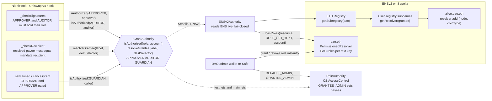
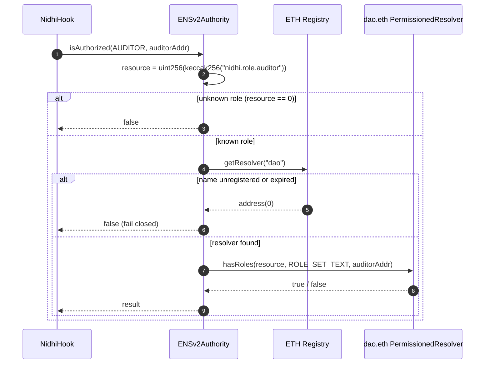
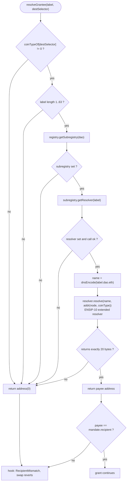
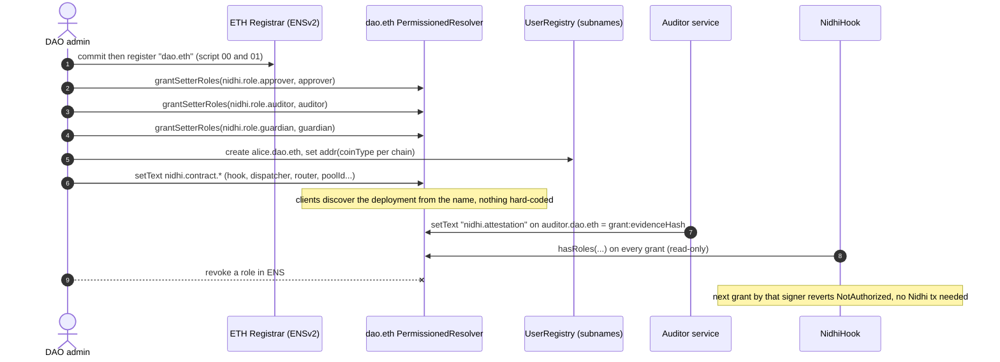
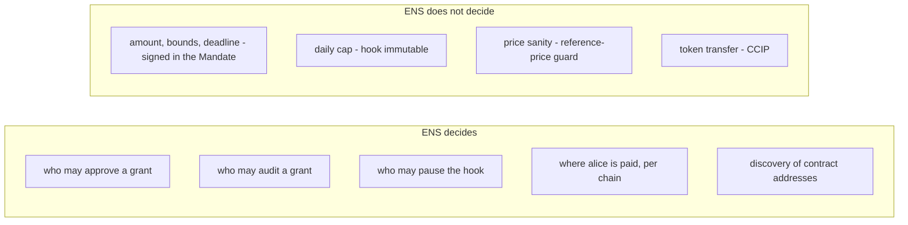

# 1. ENS architecture in Nidhi

ENS is Nidhi's **identity and permission layer**: who may approve, who may audit, who may pause, and which address a grantee
named `alice.<dao>.eth` is paid at on each chain. The hook never stores people or addresses. It asks an `IGrantAuthority`.

> **Where this runs today.** ENSv2 exists only on Sepolia, so `ENSv2Authority` is covered by the unit, invariant and live
> Sepolia fork tests and by the retired Sepolia v3 deployment. The 2026-11 testnet and mainnet deployments use the
> drop-in `RoleAuthority` (same interface, an AccessControl registry owned by the DAO admin). Same hook, different authority.

## 1.1 System view: one interface, two authorities

## 1.2 How a role check works (ENSv2Authority)

A role is an **ENS Enhanced Access Control permission on a text key of the DAO's own resolver**. Granting the right to set
`nidhi.role.auditor` on `dao.eth` IS the auditor role. Revoking it in ENS revokes it in the hook with no Nidhi transaction.

Role keys (resource = `keccak256(key)`, permission bit `ROLE_SET_TEXT = 1 << 4`):

| Role | Text key on the DAO resolver | Used for |
|---|---|---|
| APPROVER | `nidhi.role.approver` | signs the EIP-712 Mandate, may `cancelGrant` |
| AUDITOR | `nidhi.role.auditor` | signs the EIP-712 Attestation after the AI audit |
| GUARDIAN | `nidhi.role.guardian` | `setPaused` (global stop) |

The hook also requires `approver != auditor` (two different keys) before it looks at ENS at all.

## 1.3 How a grantee name becomes a payout address

`resolveGrantee(label, destSelector)` follows ENSv2 resolution and applies **ENSIP-11 per-chain addresses**: the CCIP
destination selector is mapped to coin type `0x80000000 | chainId`, so one name has a different address per chain.

Every branch that fails returns `address(0)`, so a missing, expired or malformed name can never pay anyone: **fail-closed**.

## 1.4 Setup and lifecycle of the ENS identity

## 1.5 What ENS controls vs. what it does not

