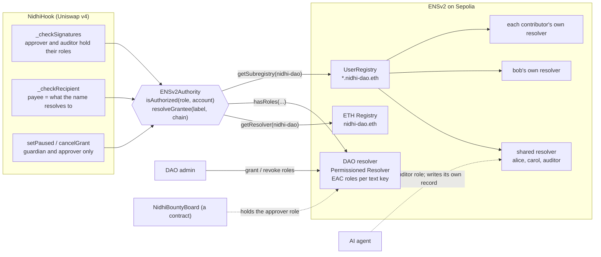
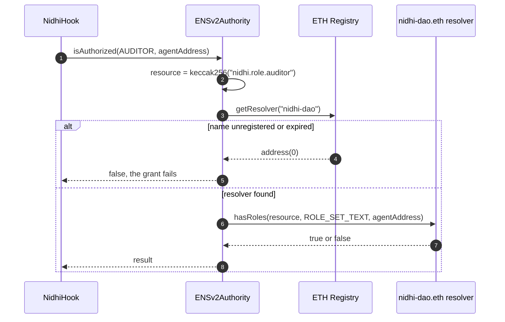
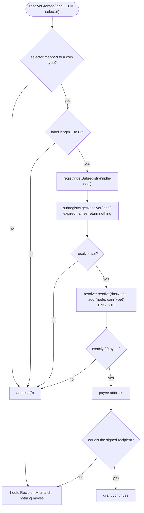
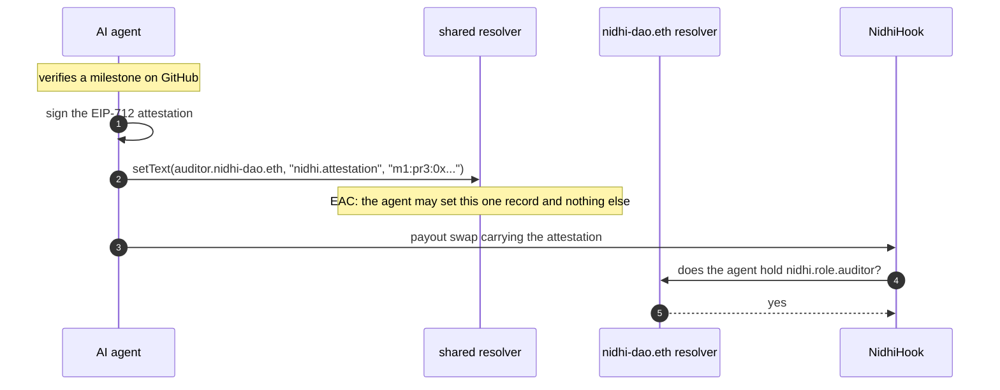
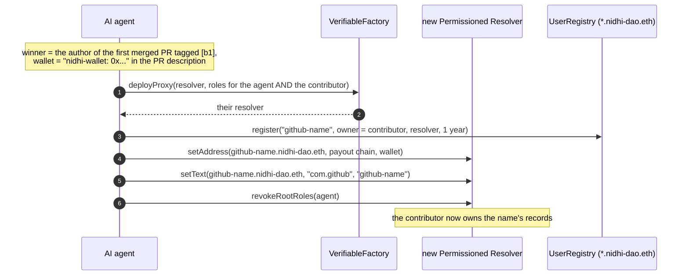
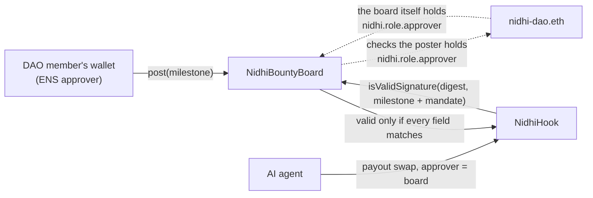

# ENSv2 in Nidhi

ENSv2 is Nidhi's **identity and permission layer**. It answers three questions on every payout:

1. **Who may act?** Approver, auditor and guardian roles live on the DAO's name, `nidhi-dao.eth`.
2. **Who is paid, and where?** Grantees are subnames (`alice.nidhi-dao.eth`) with a different address on each chain.
3. **Who is the agent?** The AI auditor is `auditor.nidhi-dao.eth`, with the right to write exactly one record.

The hook never stores people or addresses. It asks an `IGrantAuthority`, and on the ENS-gated stack that authority reads
ENSv2 live, every time.

**Where it runs.** ENSv2 is on Sepolia. The ENS-gated stack (hook, dispatcher, receivers, milestone board) is live there.
The other three chains run the same hook with `RoleAuthority`, a role registry with the same interface.

Contents: [1 system view](#1-system-view) · [2 roles are ENS permissions](#2-roles-are-ens-permissions) ·
[3 a name becomes an address](#3-a-name-becomes-an-address-per-chain) · [4 the subnames](#4-the-subnames-and-what-each-shows) ·
[5 the agent is an ENS name](#5-the-agent-is-an-ens-name) · [6 contributors get names](#6-open-bounties-contributors-get-names) ·
[7 a contract holds a role](#7-a-contract-holds-an-ens-role-the-milestone-board) · [8 fail-closed](#8-fail-closed-by-design) ·
[9 live addresses](#9-live-addresses-and-proof) · [10 code](#10-code)

---

## 1. System view

---

## 2. Roles are ENS permissions

A Nidhi role is **Enhanced Access Control permission to set one text record on the DAO's resolver**. Holding the right to
set `nidhi.role.approver` on `nidhi-dao.eth` *is* the approver role. Revoking that permission in ENS revokes the role in the
hook on the very next swap, with no Nidhi transaction.

| Role | Text key on `nidhi-dao.eth` | Allows |
|---|---|---|
| Approver | `nidhi.role.approver` | signing a payout mandate, posting a milestone, cancelling a grant |
| Auditor | `nidhi.role.auditor` | signing the attestation that the work is done |
| Guardian | `nidhi.role.guardian` | pausing every grant at once |

The hook also requires the approver and the auditor to be **two different accounts**, and checks the EIP-712 signature of
each before it asks ENS.

**Live today:** the approver key, the auditor key, the milestone board contract and the DAO admin's MetaMask all hold roles
on `nidhi-dao.eth`. The app's ENS screen checks any address against them.

---

## 3. A name becomes an address, per chain

`resolveGrantee(label, destChainSelector)` resolves `<label>.nidhi-dao.eth` through ENSv2 and reads the address for the
**payout chain**, using ENSIP-11 coin types (`0x80000000 | chainId`). One name has a different address on each chain.

| Payout chain | CCIP selector | ENSIP-11 coin type |
|---|---|---|
| Base Sepolia | 10344971235874465080 | `0x80000000 \| 84532` |
| Arbitrum Sepolia | 3478487238524512106 | `0x80000000 \| 421614` |

---

## 4. The subnames, and what each shows

Each grantee name shows a different ENSv2 capability, live:

| Name | Resolver | Shows |
|---|---|---|
| `alice.nidhi-dao.eth` | the DAO's shared Permissioned Resolver | one name, one address per payout chain (Base and Arbitrum Sepolia) |
| `bob.nidhi-dao.eth` | **his own** Permissioned Resolver | the grantee owns their data: the DAO key set the first records, then renounced its setter role with `revokeRootRoles`; only bob's wallet can change where he is paid |
| `carol.nidhi-dao.eth` | shared resolver | an **expiring** subname: its expiry is her grant period; after it, the subregistry stops resolving it and the hook refuses to pay |
| `auditor.nidhi-dao.eth` | shared resolver | an **AI agent** with its own identity and one scoped permission |
| `<github>.nidhi-dao.eth` | the contributor's own resolver | a contributor namespace created when someone wins an open bounty |

---

## 5. The agent is an ENS name

Anyone can read the agent's latest verdict from ENS. The app's ENS screen shows it live.

---

## 6. Open bounties: contributors get names

When someone wins an open bounty, they may not have an ENS name yet. The agent gives them one, and then hands it over.

- `com.github` is the standard ENS text key for a GitHub account. The agent refuses to pay a name whose `com.github`
  belongs to someone else, so nobody can squat a winner's name.
- The same name is reused for every later bounty that person wins.

---

## 7. A contract holds an ENS role: the milestone board

`NidhiBountyBoard` holds the **approver role on `nidhi-dao.eth`**, like a person would. The hook verifies approvers with
ERC-1271 when the approver is a contract, so the board can "sign" a payout without a human at payout time. It does so only
for a payout that matches a milestone an ENS approver posted on-chain.

Revoking the board's ENS role stops every on-chain milestone at once (tested: `test_revokingTheBoardsRoleStopsPayouts`).

---

## 8. Fail-closed by design

| Situation | Result |
|---|---|
| `nidhi-dao.eth` expires | `currentResolver()` returns zero: no roles, every payout stops |
| A grantee subname expires (carol) | no resolver: `RecipientMismatch` |
| No address for that chain | `address(0)`: `RecipientMismatch` |
| A role is revoked | `NotAuthorized` on the next swap |
| A malformed record, a broken resolver | `address(0)`: nothing moves |
| An unknown name (`mallory`) | refused, verified against live Sepolia state |

---

## 9. Live addresses and proof

| What | Where |
|---|---|
| `ENSv2Authority` | [`0x92ceAa59…5600`](https://sepolia.etherscan.io/address/0x92ceAa59dfB8Ce4A85dCECFd26e50Ba58e375600) |
| `nidhi-dao.eth` resolver | [`0x0D919208…aBbF`](https://sepolia.etherscan.io/address/0x0D919208f68a4156E7580B9101171fa72dECaBbF) |
| UserRegistry `*.nidhi-dao.eth` | [`0x562FB95c…C656`](https://sepolia.etherscan.io/address/0x562FB95c17272B850c99496e565bA5eCEDA6C656) |
| bob's own resolver | [`0x0faD784c…4a29`](https://sepolia.etherscan.io/address/0x0faD784c4f25b3612Ad2f728632A8737aBBE4a29) |
| Milestone board (an ENS approver) | [`0xC4CDeeD4…2f2a`](https://sepolia.etherscan.io/address/0xC4CDeeD49580786f0262779472E3e63d95952f2a) |
| ENS-gated grant to `alice.nidhi-dao.eth`, settled | [swap](https://sepolia.etherscan.io/tx/0x696887ae1880740414a2746ad6c2e764f248781ecf26eaaaabcda723088fe3e0) |
| Agent milestone payout, ENS-gated | [publish](https://sepolia.etherscan.io/tx/0x5d65178ca1498a1eb23e2efb15039460bd2b1621c31d26aa96fd19da048ad080) · [payout](https://sepolia.etherscan.io/tx/0xb8f24e16f4fe2bfa71d205e3ac48d13541a7a42ff0d35abbd8b5a9119408cfaf) |
| bob takes ownership of his resolver | [renounce](https://sepolia.etherscan.io/tx/0xe39eb0a174890df7e9771519cf1c9e619a58128a792a5f2cbf05c779bc570e73) |

---

## 10. Code

| What | Where |
|---|---|
| Roles from EAC | [`ENSv2Authority.isAuthorized`](../../src/ENSv2Authority.sol#L94) |
| Per-chain payee | [`ENSv2Authority.resolveGrantee`](../../src/ENSv2Authority.sol#L105) |
| The hook's checks | [`_checkSignatures`](../../src/NidhiHook.sol#L290) · [`_checkRecipient`](../../src/NidhiHook.sol#L337) · [`_isValidSignature`](../../src/NidhiHook.sol#L349) (ECDSA, then ERC-1271) |
| alice, bob, carol | [`script/ens/EnsSetup.s.sol`](../../script/ens/EnsSetup.s.sol) |
| Board and role grants | [`script/ens/BountySetup.s.sol`](../../script/ens/BountySetup.s.sol) |
| Contributor names | [`offchain/src/bounty.ts`](../../offchain/src/bounty.ts) (`ensureContributorName`, `githubOf`) |
| Tests on the real ENSv2 contracts | [`test/fork/LiveSepolia.t.sol`](../../test/fork/LiveSepolia.t.sol) · [`test/unit/ENSv2Authority.t.sol`](../../test/unit/ENSv2Authority.t.sol) |
