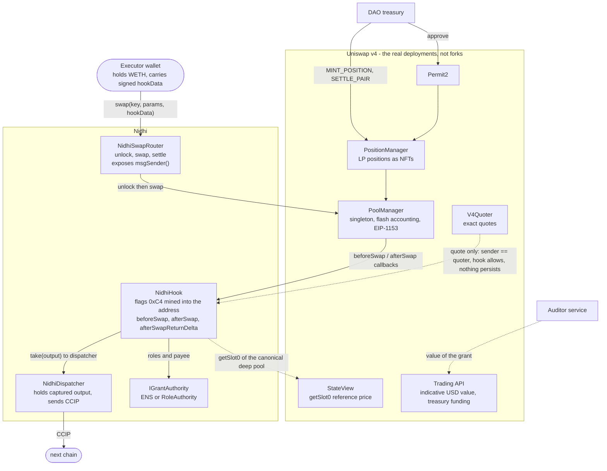
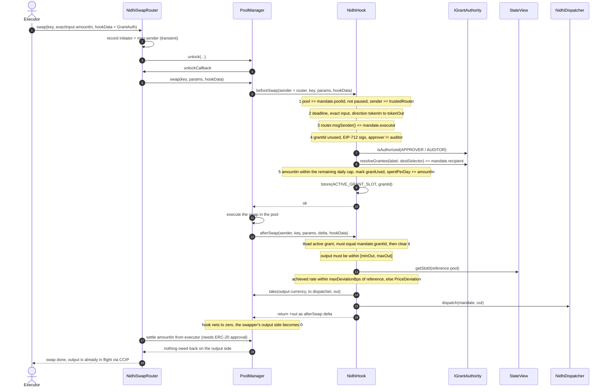
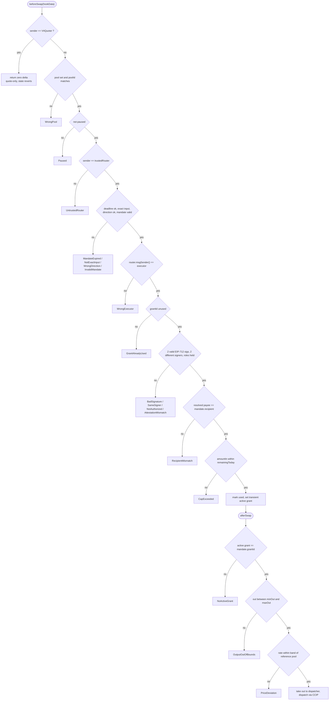
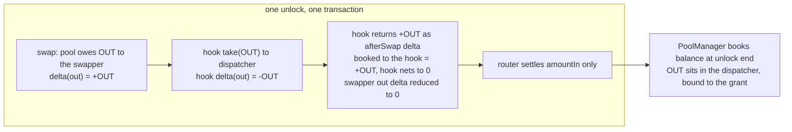
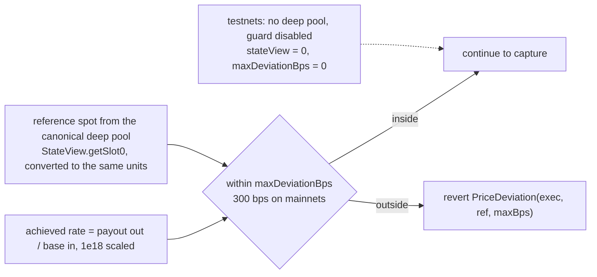

# 2. Uniswap v4 architecture in Nidhi

Uniswap v4 is Nidhi's **execution and enforcement layer**. A grant is not "send money": it is a **swap that cannot happen
unless a signed mandate is attached**, whose output never reaches the caller. The hook enforces the rules inside the swap.

## 2.1 System view: Uniswap contracts and Nidhi's additions

## 2.2 The pool

| Property | Value |
|---|---|
| Pair | wrapped native (WETH or equivalent) / payout token (USDC on mainnets, CCIP-BnM on testnets) |
| Fee, tick spacing | 3000 (0.30%), 60 |
| Hook | `NidhiHook`, address mined so its low bits equal `0xC4` = `BEFORE_SWAP | AFTER_SWAP | AFTER_SWAP_RETURNS_DELTA` |
| Hook deployment | CREATE2 through the canonical deployer `0x4e59...956C`, salt found by `HookMiner` per chain (PoolManager differs per chain) |
| Initial price | mainnets: the canonical deep pool's price; testnets: about 1 WETH = 1000 payout tokens |
| Liquidity | one **payout-token-only** position through PositionManager (an NFT). Base-to-payout grant swaps pull the payout token out of it |
| Why not a test router | `PoolModifyLiquidityTest` positions can be drained by anyone. A PositionManager NFT is owned by the DAO |

## 2.3 One grant swap, call by call

## 2.4 What the hook enforces, and the exact error when it fails

Any revert inside a hook is wrapped by the PoolManager as `WrappedError(hook, selector, reason, HookCallFailed)`. Tests unwrap
it and assert the exact inner selector, so a swap cannot "revert for the wrong reason" and still pass.

## 2.5 Flash accounting: why the swapper never touches the output

## 2.6 Uniswap tools and what each does here

| Tool | Role in Nidhi |
|---|---|
| **PoolManager** | executes the swap, runs the hook, flash accounting settles it |
| **Hooks (v4)** | the policy engine: mandate, roles, cap, bounds, guard, capture |
| **PositionManager and Permit2** | the DAO's USDC-only LP position as an NFT, with Permit2 allowance |
| **V4Quoter** | exact-input quotes for a mandate's band. The hook recognises it (`sender == quoter`) and stays side-effect-free |
| **StateView** | on-chain reference-price guard against the canonical deep pool |
| **Trading API** | off-chain: indicative USD value in the audit, and treasury funding swaps. Nidhi's own swap uses its router so the hook can read the real initiator |
| **ReservesLens** | recorded in the registry for dashboard pool state |

## 2.7 Reference-price guard

