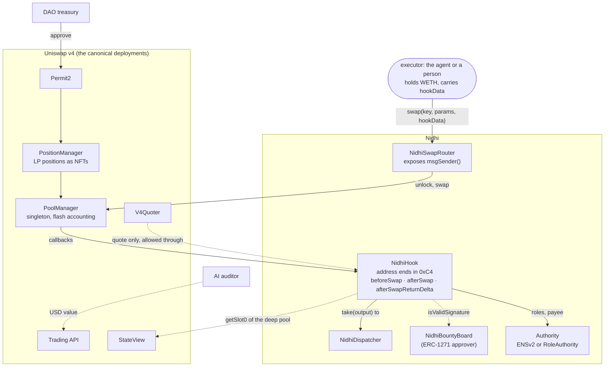
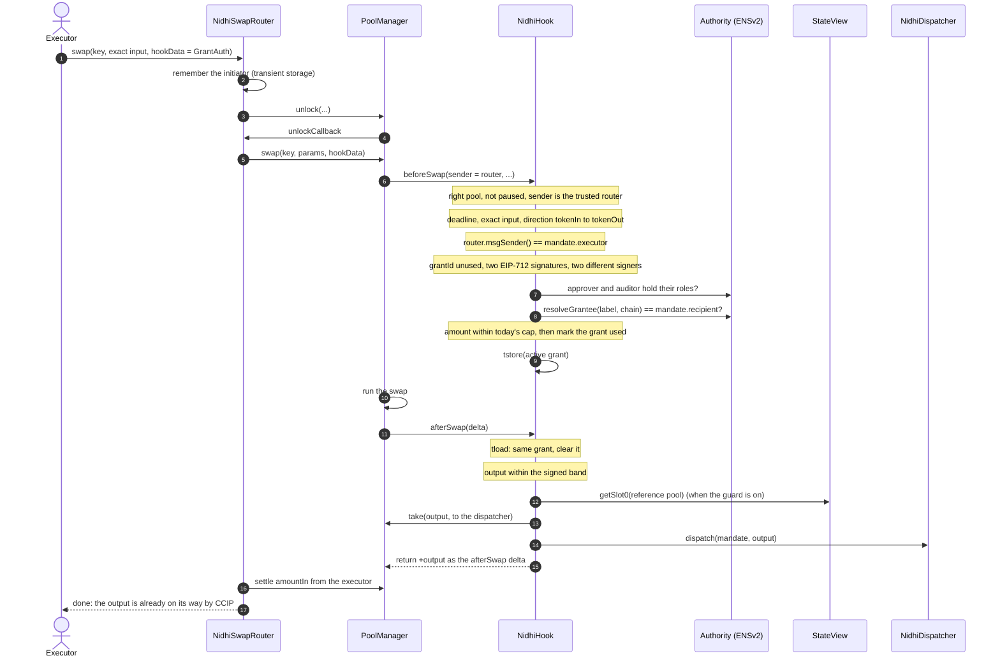
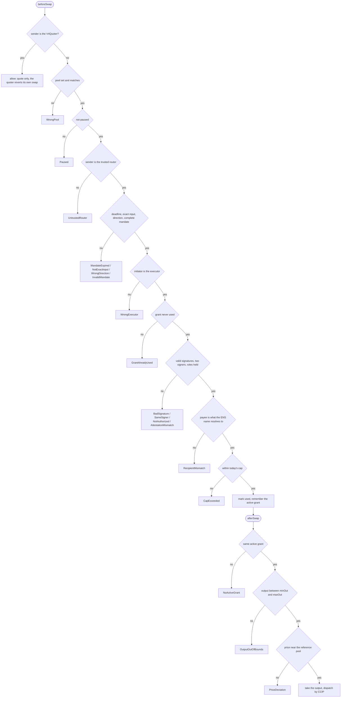
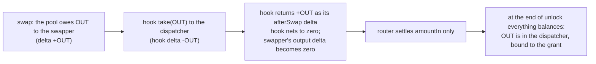
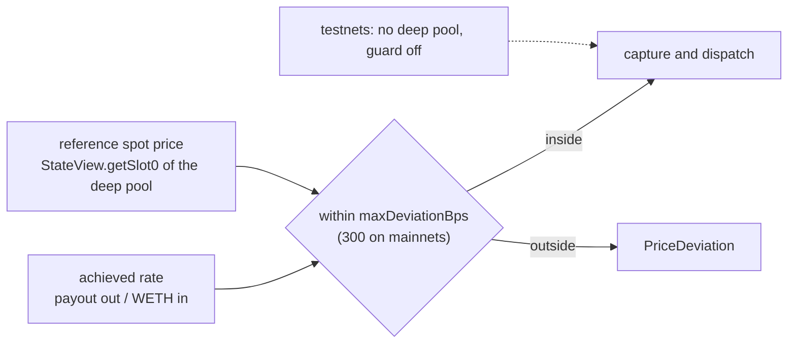

# Uniswap v4 in Nidhi

Uniswap v4 is Nidhi's **execution and enforcement layer**. A grant is not "send money". It is a **swap that cannot happen
unless a valid mandate rides along with it**, and whose output never reaches the person who sent it. Every rule is checked
inside the swap by the hook, so there is no gap between "approved" and "paid".

Contents: [1 system view](#1-system-view) · [2 the pool](#2-the-pool) · [3 a grant swap, call by call](#3-a-grant-swap-call-by-call) ·
[4 every check and its error](#4-every-check-and-its-error) · [5 flash accounting](#5-flash-accounting-why-the-swapper-never-touches-the-output) ·
[6 the trusted router](#6-the-trusted-router-who-really-sent-the-swap) · [7 quoting through a gated hook](#7-quoting-through-a-gated-hook) ·
[8 the price guard](#8-the-reference-price-guard-stateview) · [9 contract approvers](#9-a-contract-as-approver-erc-1271) ·
[10 liquidity](#10-liquidity-a-positionmanager-nft) · [11 tools used](#11-every-uniswap-tool-and-its-job) · [12 multi-chain](#12-one-hook-every-chain) ·
[13 code](#13-code)

---

## 1. System view

---

## 2. The pool

| Property | Value |
|---|---|
| Pair | wrapped native (WETH) / payout token (USDC on mainnets, CCIP-BnM on testnets) |
| Fee, tick spacing | 3000 (0.30%), 60 |
| Hook flags | `0xC4` = `BEFORE_SWAP` + `AFTER_SWAP` + `AFTER_SWAP_RETURNS_DELTA`, mined into the hook's address |
| Hook deployment | CREATE2 through the canonical deployer, salt found by `HookMiner` for each chain (each chain's PoolManager differs, so each chain needs its own salt) |
| Opening price | mainnets: the canonical deep pool's price; testnets: about 1 WETH = 1000 payout tokens |
| Liquidity | one payout-token-only position held as a PositionManager NFT, owned by the DAO |

Grant swaps go from WETH to the payout token and pull from that single-sided position.

---

## 3. A grant swap, call by call

---

## 4. Every check, and its error

The PoolManager wraps a hook revert as `WrappedError(hook, selector, reason, HookCallFailed)`. Tests unwrap it and assert
the exact inner error, and the app decodes it into one plain sentence.

---

## 5. Flash accounting: why the swapper never touches the output

The executor puts in WETH and receives nothing. The payout token goes from the PoolManager to the dispatcher in the same
transaction, and from there into a CCIP message. EIP-1153 transient storage carries the active grant from `beforeSwap` to
`afterSwap`.

---

## 6. The trusted router: who really sent the swap

In a v4 hook, `sender` is the contract that called the PoolManager, not the person. `NidhiSwapRouter` records the real
initiator in transient storage and exposes it through `msgSender()`. The hook accepts swaps only from this router, and
requires `msgSender()` to equal the mandate's executor, so nobody can front-run a signed mandate.

---

## 7. Quoting through a gated hook

A hook that reverts unauthorised swaps also reverts quotes, because the V4Quoter simulates a swap. Nidhi passes the chain's
canonical V4Quoter into the hook, and the hook lets `sender == quoter` through with a zero delta. The quoter always reverts
its own simulated swap, so nothing persists. The app quotes every grant and milestone this way.

---

## 8. The reference-price guard (StateView)

A hooked pool is a new, thinner pool. On mainnet the hook compares each grant's execution price with the canonical deep v4
pool, read through StateView, so a skewed or sandwiched hooked pool cannot pay out at a bad price. No external oracle is needed.

---

## 9. A contract as approver (ERC-1271)

The hook verifies signatures with ECDSA first, then ERC-1271 for contract signers. That is what lets `NidhiBountyBoard`
approve on-chain milestones: it is the mandate's `approver`, and it answers `isValidSignature` with "valid" only when the
mandate matches a posted milestone and hashes to the exact digest the hook computed (`hook.mandateDigest`). The hook itself
needed no change to support milestones or open bounties.

---

## 10. Liquidity: a PositionManager NFT

The DAO's liquidity is minted through the PositionManager (`MINT_POSITION` + `SETTLE_PAIR`, with Permit2 approval) and held
as an NFT owned by the DAO admin. An earlier version seeded liquidity through v4's test router, whose positions anyone can
remove; `test/fork/DrainCheck.t.sol` proves that, and is why production uses the PositionManager.

---

## 11. Every Uniswap tool, and its job

| Tool | Job in Nidhi |
|---|---|
| **PoolManager** | runs the swap and the hook; flash accounting settles it |
| **v4 hooks** | the policy engine: mandate, roles, payee, cap, band, guard, capture |
| **PositionManager + Permit2** | the DAO's liquidity as an NFT |
| **V4Quoter** | exact quotes for every grant and milestone, through the gated hook |
| **StateView** | the reference-price guard, and the app's live pool price |
| **Trading API** | the auditor's USD valuation and treasury funding swaps (off-chain) |
| **Universal Router** | used by the Trading API for treasury swaps; Nidhi's own swap uses its router so the hook can see the real initiator |

---

## 12. One hook, every chain

The deploy scripts are driven by `chains/registry.json`, generated from Uniswap's deployments and checked on-chain. The same
hook runs on four testnets today, and was rehearsed on forks of the v4 mainnets: Ethereum, Base, Arbitrum, Polygon,
Avalanche, HyperEVM and Monad pass.

| Chain (live) | Hook |
|---|---|
| Sepolia | [`0xa020A751…c0c4`](https://sepolia.etherscan.io/address/0xa020A75106A7a5094Fb0530692Ee8aaADe7fc0c4) and the ENS-gated [`0x88257DA3…80c4`](https://sepolia.etherscan.io/address/0x88257DA3a88Aaaf8b3EEF52112Bfb9C3596580c4) |
| Base Sepolia | [`0xB703D879…80c4`](https://sepolia.basescan.org/address/0xB703D879B1F3fE33184841B42bc61097133A80c4) and the hop stack [`0xFAc8F26e…80c4`](https://sepolia.basescan.org/address/0xFAc8F26eE3993C86001318E5D21c2D705a2A80c4) |
| Arbitrum Sepolia | [`0x56d56254…80c4`](https://sepolia.arbiscan.io/address/0x56d56254A518142375E9eA9a69f310aB8D7b80c4) |
| Unichain Sepolia | [`0x2835f2af…C0c4`](https://unichain-sepolia.blockscout.com/address/0x2835f2af22486B547EE2E3F94805160b380bC0c4) |

Every hook address ends in `c4`: the permission bits.

---

## 13. Code

| What | Where |
|---|---|
| Permissions | [`getHookPermissions`](../../src/NidhiHook.sol#L172) |
| Every pre-swap check | [`_beforeSwap`](../../src/NidhiHook.sol#L242) · [`_checkSignatures`](../../src/NidhiHook.sol#L290) · [`_checkRecipient`](../../src/NidhiHook.sol#L337) |
| Capture and dispatch | [`_afterSwap`](../../src/NidhiHook.sol#L357) |
| Price guard | [`_checkReferencePrice`](../../src/NidhiHook.sol#L321) |
| ECDSA then ERC-1271 | [`_isValidSignature`](../../src/NidhiHook.sol#L349) |
| Guardian, cancellation | [`setPaused`](../../src/NidhiHook.sol#L204) · [`cancelGrant`](../../src/NidhiHook.sol#L212) |
| Router | [`msgSender`](../../src/NidhiSwapRouter.sol#L39) · [`swap`](../../src/NidhiSwapRouter.sol#L56) · [`unlockCallback`](../../src/NidhiSwapRouter.sol#L88) |
| Deploy: mining, pool, LP NFT | [`script/mainnet/Deploy.s.sol`](../../script/mainnet/Deploy.s.sol) |
| Tests | [`NidhiFlow.t.sol`](../../test/unit/NidhiFlow.t.sol) · [`QuoterPath.t.sol`](../../test/unit/QuoterPath.t.sol) · [`MultiChain.t.sol`](../../test/unit/MultiChain.t.sol) · [`BountyBoard.t.sol`](../../test/unit/BountyBoard.t.sol) · [`LiveSepolia.t.sol`](../../test/fork/LiveSepolia.t.sol) |
