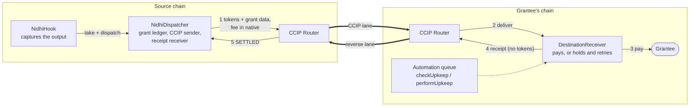
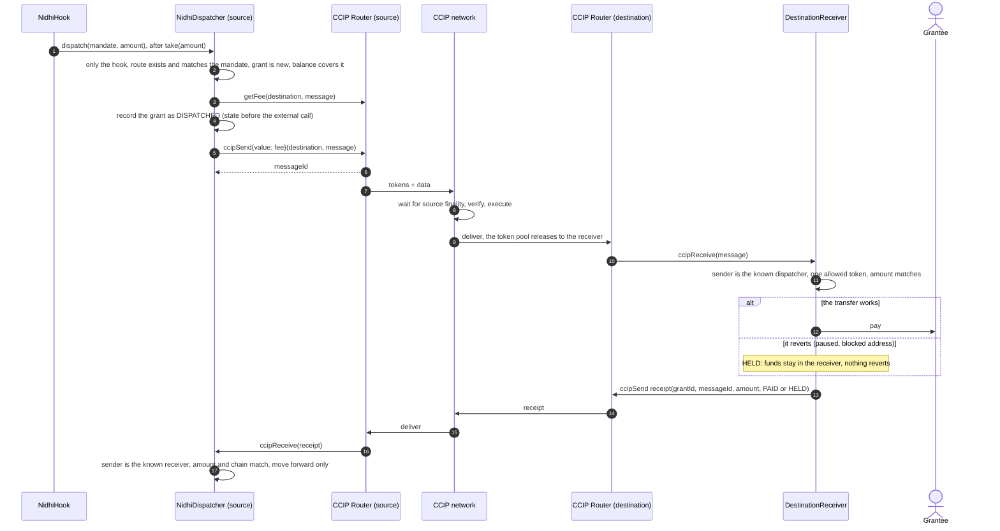
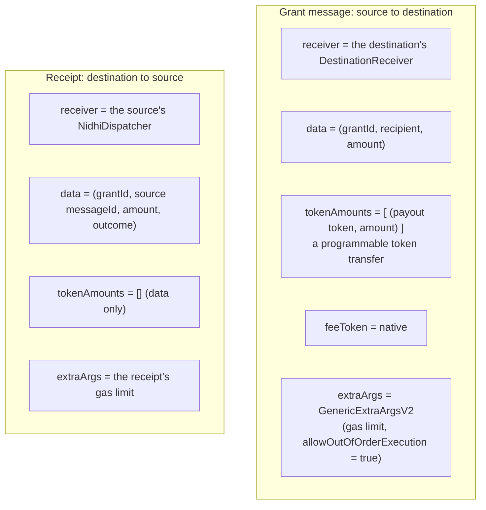
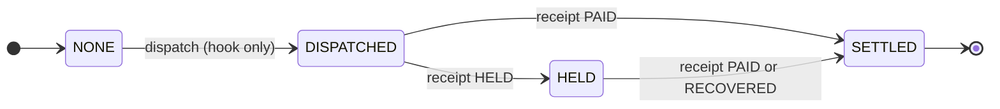
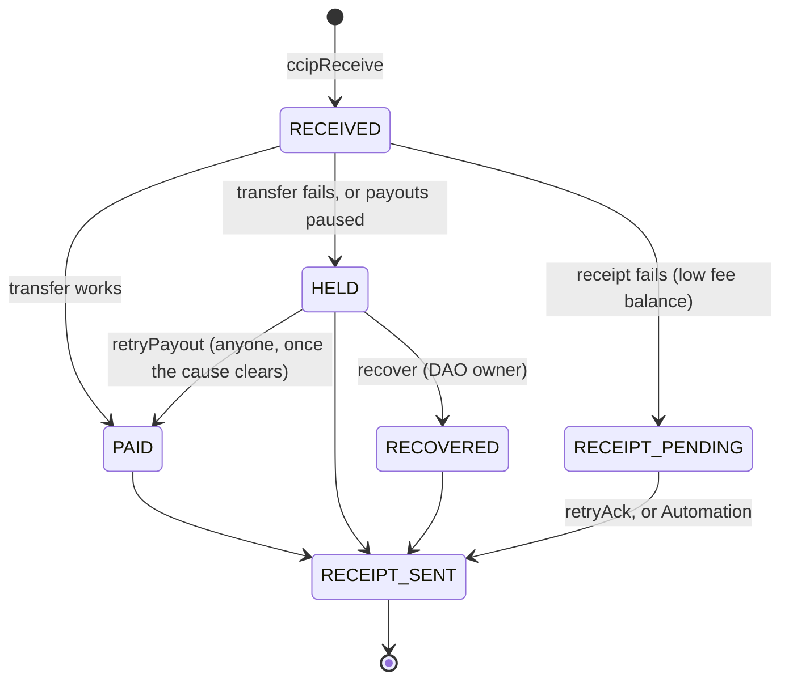
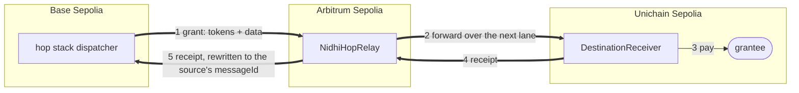
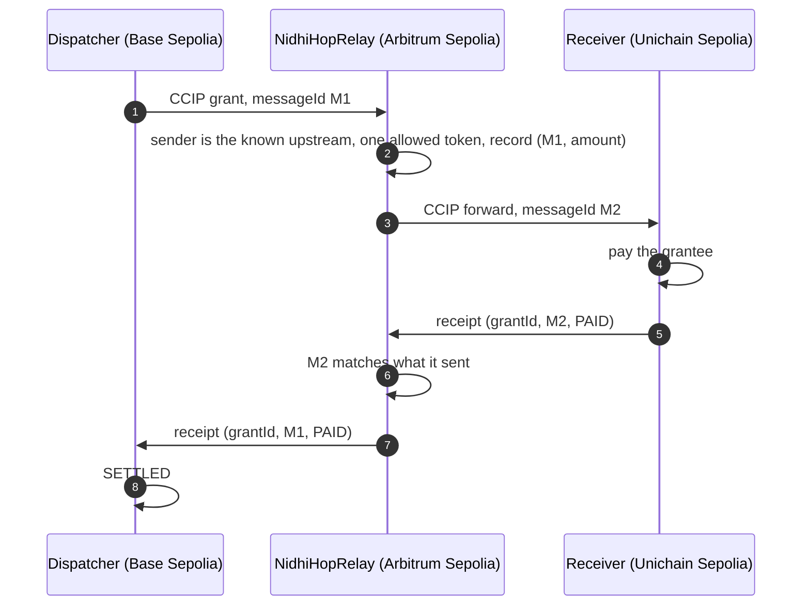
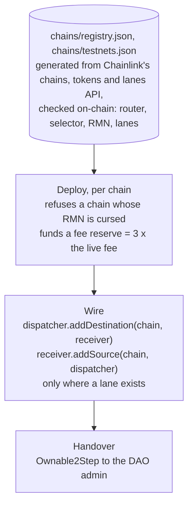
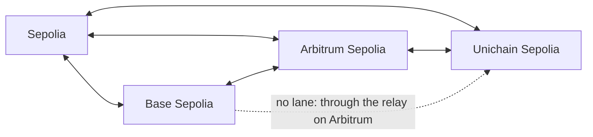
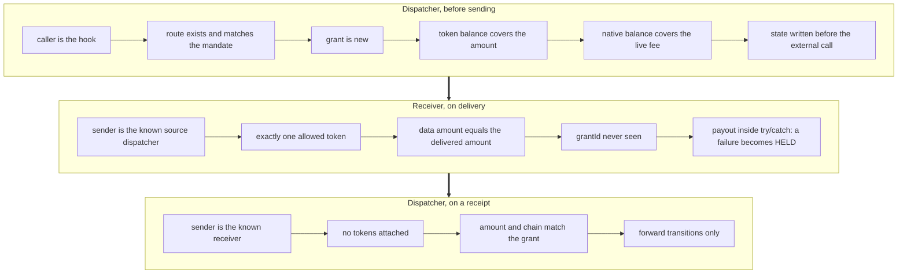

# Chainlink CCIP 2.0 in Nidhi

CCIP is Nidhi's **cross-chain settlement layer**. The hook captures the swap output on the source chain. CCIP carries that
exact amount, together with the grant data, to a receiver on the grantee's chain, which pays them. A second CCIP message
travels back as a **receipt**, so the source ledger knows the grant was paid and marks it `SETTLED`. A relay pays chains
that have no direct lane.

Contents: [1 system view](#1-system-view) · [2 the round trip](#2-the-full-round-trip) · [3 the messages](#3-what-goes-in-each-message) ·
[4 the ledger](#4-the-source-ledger-only-moves-forward) · [5 the receiver never loses money](#5-the-receiver-never-loses-money) ·
[6 multi-hop](#6-multi-hop-paying-a-chain-with-no-direct-lane) · [7 lanes and routing](#7-lanes-and-add-only-routing) ·
[8 safety checks](#8-safety-checks-around-every-message) · [9 CCIP 2.0 specifics](#9-ccip-20-specifics-and-lessons-from-live-runs) ·
[10 costs and timing](#10-costs-and-timing) · [11 live proof](#11-live-proof) · [12 code](#12-code)

---

## 1. System view

Every chain runs both halves (a dispatcher and a receiver), so any lane works in both directions and every receipt returns
on the reverse lane.

---

## 2. The full round trip

---

## 3. What goes in each message

Receipt outcomes: `PAID`, `HELD`, `RECOVERED`.

---

## 4. The source ledger only moves forward

A receipt that would move a grant backwards, arrives twice, comes from an unknown sender, or names the wrong amount or chain
is rejected. The receipt can even arrive in the same transaction as the send (local simulator); the message id is reconciled
from whichever side lands first.

---

## 5. The receiver never loses money

A reverted CCIP delivery would need manual execution, and the tokens would sit in limbo. So the receiver never reverts a
delivery: it records a failure and heals later.

Held payouts and unsent receipts go into a queue that Chainlink Automation can drain through `checkUpkeep` and
`performUpkeep` (up to 10 per run). The owner can never sweep grant tokens: `withdrawFees` refuses them.

---

## 6. Multi-hop: paying a chain with no direct lane

Chainlink's track description asks for exactly this: *send from chain A to chain B without worrying whether the lane
exists*. Base Sepolia and Unichain Sepolia share no CCIP lane. `NidhiHopRelay` on Arbitrum Sepolia joins them.

- **No existing contract changes.** To the source dispatcher, the relay *is* the destination receiver. To the final
  receiver, the relay *is* the source dispatcher.
- **The receipt still settles the source.** The relay rewrites the receipt to carry the source's own message id, which is
  what the dispatcher matches.
- **Nothing is lost if a hop fails.** A forward or a receipt that cannot be sent is parked; anyone can call `retryForward`
  or `retryAck`.
- **Hardened by the live run.** The relay forwards inside CCIP's delivery, so the source must give it enough gas (2,000,000
  on CCIP 2.0 testnet on-ramps); the first live hop ran out at the default 600,000, parked safely, and was retried. The hop
  script now sets the limits for every route.

---

## 7. Lanes and add-only routing

A grant can only go where Chainlink runs a lane, and a route, once added, can never be redirected.

On mainnets the payout token is USDC through CCIP's USDC pools: 10 source-capable chains and 50 directed lanes, rehearsed on
forks.

---

## 8. Safety checks around every message

The RMN curse status is checked before deploying and shown live in the app.

---

## 9. CCIP 2.0 specifics, and lessons from live runs

- **CCIP 2.0 contracts.** The contracts build on Chainlink's current CCIP library, which includes the cross-chain verifier
  configuration (`getCCVsAndFinalityConfig`). On the live testnet lanes, the token pools call `getRequiredCCVs` during fee
  quoting, visible in our deployment traces.
- **`GenericExtraArgsV2`** with `allowOutOfOrderExecution`, isolated in one library (`ExtraArgsLib`).
- **Faster-Than-Finality (FTF), CCIP 2.0.** By default a message waits for full source finality. CCIP 2.0 lets the
  sender ask for a block depth instead (`GenericExtraArgsV3`, `FinalityCodec`), but only if the receiver opts in.
  Otherwise the message is accepted at send time and then fails on execution. Nidhi does both halves:
  - `NidhiDispatcher.setRequestedFinality(destSelector, depth)` is per lane and owner-only. With nothing set it sends the
    old V2 bytes, unchanged.
  - `DestinationReceiver.setAllowedFinality(depth)` controls what `getCCVsAndFinalityConfig` returns. It allows the
    shallower depth **only for its own known source dispatcher**. Every other sender, and every unknown chain, still gets
    full finality.
  - Each lane sets its own minimum depth. Live checks: Sepolia → Base and Sepolia → Arbitrum require at least 32 blocks;
    Unichain → Arbitrum accepts 20. Lanes sourced from Base or Arbitrum are finality-only. The v5 ENS stack therefore
    asks for 32 blocks on its Sepolia lanes (about 6.4 min instead of about 15 min for finality), and its receivers accept 20 or more.
  - Tests: `test/unit/FasterThanFinality.t.sol`.
- **Gas limits matter more than they look.** A receiver pays and sends a receipt inside its delivery; a relay sends a whole
  new CCIP message inside its delivery. Destination gas limits are set per route (2,000,000 for hops, 1,500,000 for a final
  receiver's receipt).
- **Gas estimation and try/catch.** An estimator picks the lowest gas at which the outer call succeeds, and a failing send
  inside try/catch still "succeeds". Manual retries need an explicit gas limit.
- **Local simulator.** It delivers every hop in one transaction, so a two-hop test needs the whole route's gas in the first
  hop, and a receipt can arrive before the send returns. The relay reconciles that order.

---

## 10. Costs and timing

| | Who pays | How |
|---|---|---|
| Grant message | the source dispatcher | native token, quoted live with `getFee` |
| Receipt | the destination receiver | native token, from its own reserve |
| Hop forward and relayed receipt | the relay | native token, from its reserve |
| Reserve sizing | the deployer | 3 messages' worth of the live fee per side |

A direct grant costs two CCIP messages; a two-hop grant costs four. On testnets a grant takes about 15–25 minutes to reach
the grantee and 30–40 minutes to settle, mostly waiting for source-chain finality. With Faster-Than-Finality (the v5 ENS
stack, 32 blocks on Sepolia) the outbound leg waits 32 blocks instead of finality. Measured live on 6 Nov 2026:

| Grant | Lane | Sent | Paid to grantee | Time |
|---|---|---|---|---|
| `0xfd54…586d` | Sepolia → Base Sepolia | 08:31:00 UTC | 08:37:36 UTC | **6 min 36 s** |
| `0x7828…6a79` | Sepolia → Arbitrum Sepolia | 08:39:36 UTC | 08:46:51 UTC | **7 min 15 s** |

Before FTF the same lanes took 15–25 minutes. The receipt leg from
Base or Arbitrum still waits for finality, because those lanes allow nothing else.

---

## 11. Live proof

| Route | Evidence |
|---|---|
| Base Sepolia → Arbitrum Sepolia, settled | [CCIP](https://ccip.chain.link/msg/0x60433b4f9215063950bde9736f3618766fdbbdde7f43e895dba724fc3d2faf7e) · [payout](https://sepolia.arbiscan.io/tx/0x74c5f98f165389683c3201ce3b283e63e9965eaed03c5faed8d389e8f6d3c21c) |
| Sepolia → Base Sepolia, settled | [CCIP](https://ccip.chain.link/msg/0x9c3ddac23e4af71f197c9b71b36b36f11fdbc8068e25c8c6d36468d65ff1fdfa) · [payout](https://sepolia.basescan.org/tx/0xf3e05ffddcbd9e86ca12ae3c84783a1f1482824613f4ed6cbdf9449e1d628294) |
| ENS-gated Sepolia → Base Sepolia, settled | [CCIP](https://ccip.chain.link/msg/0xe5721859a03a43697d7ce3b2c5fcd8a73a5d5c9ed881ab34db33edb4ccba17a2) |
| **Multi-hop** Base Sepolia → Arbitrum Sepolia → Unichain Sepolia, settled | [swap](https://sepolia.basescan.org/tx/0x47c75cf9e20812733516d2a5642f39111a476efc2b8af1f569dbb6480cc14168) · [relay forward](https://sepolia.arbiscan.io/tx/0xeab38417c58e402c2d7e9c5f3491d0adbb1217bb44ebef1aa2e4ed11c1c8977f) |
| Agent milestone payout, Sepolia → Base Sepolia | [payout swap](https://sepolia.etherscan.io/tx/0xb8f24e16f4fe2bfa71d205e3ac48d13541a7a42ff0d35abbd8b5a9119408cfaf) |

---

## 12. Code

| What | Where |
|---|---|
| Send | [`NidhiDispatcher.dispatch`](../../src/NidhiDispatcher.sol#L120) |
| Receipt in | [`NidhiDispatcher._ccipReceive`](../../src/NidhiDispatcher.sol#L182) |
| Delivery, hold, retry, recover | [`DestinationReceiver._ccipReceive`](../../src/DestinationReceiver.sol#L119) · [`retryPayout`](../../src/DestinationReceiver.sol#L165) · [`recover`](../../src/DestinationReceiver.sol#L180) · [`sendAck`](../../src/DestinationReceiver.sol#L211) |
| Automation | [`checkUpkeep`](../../src/DestinationReceiver.sol#L263) · [`performUpkeep`](../../src/DestinationReceiver.sol#L277) |
| Multi-hop | [`NidhiHopRelay`](../../src/NidhiHopRelay.sol): [`_onGrant`](../../src/NidhiHopRelay.sol#L134) · [`_onAck`](../../src/NidhiHopRelay.sol#L152) · [`retryForward`](../../src/NidhiHopRelay.sol#L235) |
| Message encoding | [`AckLib`](../../src/libraries/AckLib.sol) · [`ExtraArgsLib`](../../src/libraries/ExtraArgsLib.sol) |
| Routes | [`script/mainnet/Wire.s.sol`](../../script/mainnet/Wire.s.sol) · [`script/hop/HopRoute.s.sol`](../../script/hop/HopRoute.s.sol) |
| Tests | [`NidhiFlow.t.sol`](../../test/unit/NidhiFlow.t.sol) · [`EdgeCases.t.sol`](../../test/unit/EdgeCases.t.sol) · [`HopRelay.t.sol`](../../test/unit/HopRelay.t.sol) · [`NidhiInvariant.t.sol`](../../test/invariant/NidhiInvariant.t.sol) |
