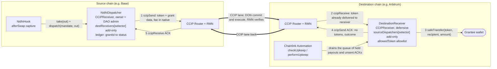
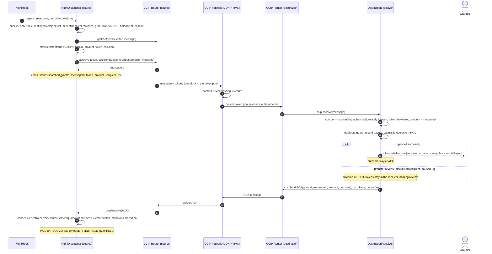
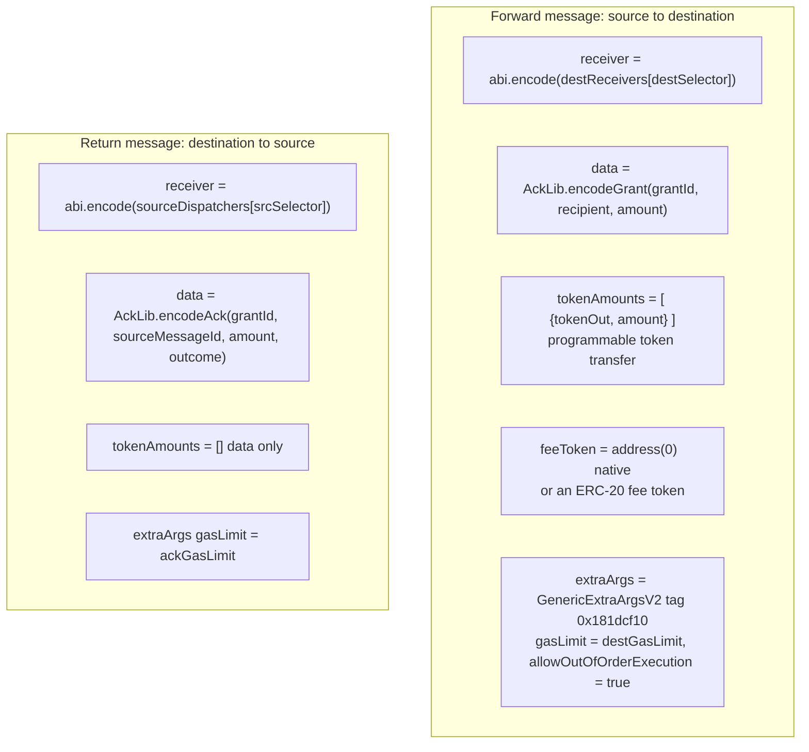
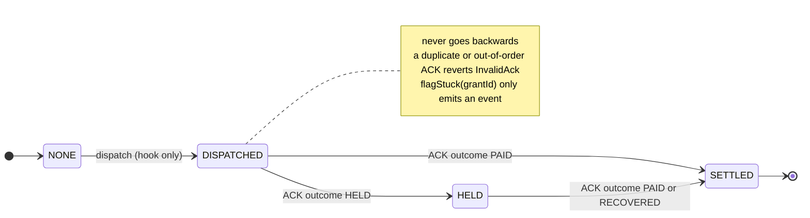
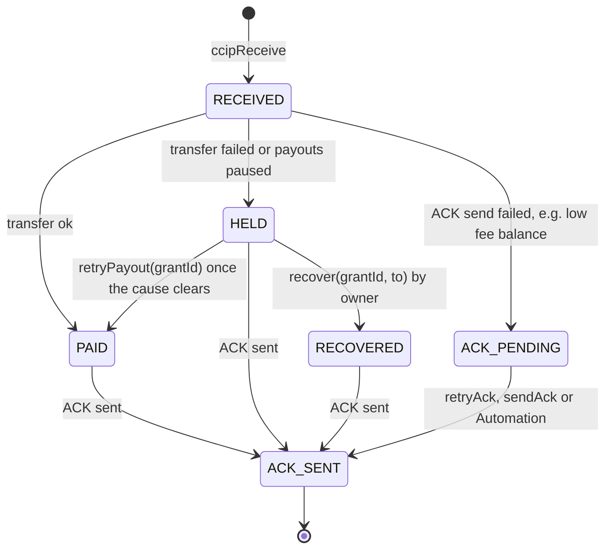
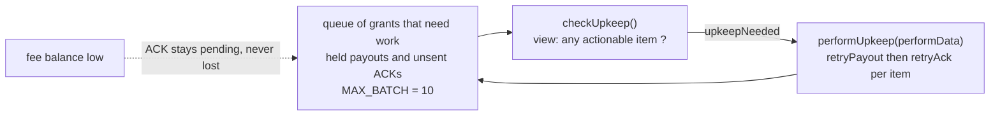
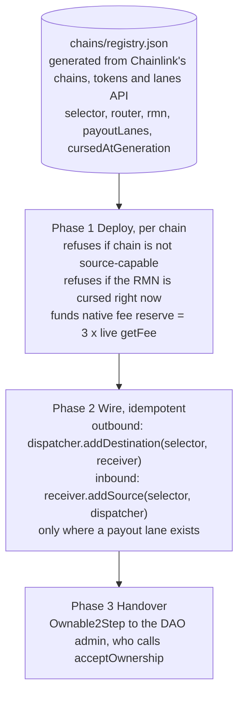
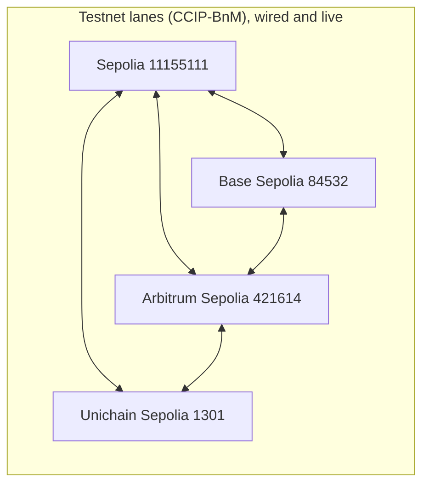
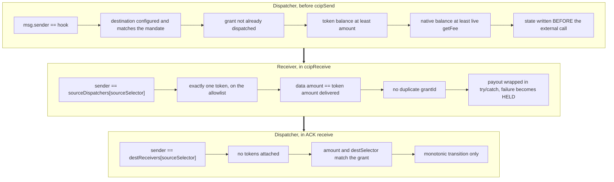

# 3. Chainlink CCIP architecture in Nidhi

CCIP is Nidhi's **cross-chain settlement layer**. The hook captures the swap output on the source chain. CCIP carries that
exact token amount, plus the grant data, to a receiver on the destination chain that pays the grantee. A second CCIP message
travels back as a **receipt (ACK)** so the source ledger knows the grant is `SETTLED`.

## 3.1 System view

Every chain deploys **both** sides (a dispatcher and a receiver), so any lane works in either direction, and the ACK always
returns on the reverse lane.

## 3.2 The full round trip

## 3.3 What goes in the CCIP message

Outcome codes carried in the ACK: `PAID`, `HELD`, `RECOVERED`.

## 3.4 The grant ledger is monotonic

## 3.5 Destination payout states and self-healing

The receiver never reverts a CCIP delivery, because a reverted message would need manual execution and the tokens would be
stranded. It records the failure and heals later.

Funds safety on the receiver: `withdrawFees` refuses allowlisted payout tokens, so an owner cannot sweep grant money.

## 3.6 Lanes and routing across many chains

Nidhi is **lane-aware and add-only**. A chain can only pay a destination that has a real CCIP lane, and a route can be added
but never overwritten.

On mainnets the payout token is **USDC**, bridged by CCIP's USDC pools. 10 chains are source-capable, with 50 directed USDC
lanes. The optimism, unichain and ink RMNs were **cursed at generation time**, so Deploy refuses them and rehearsals skip them.

## 3.7 Safety checks around every CCIP call

## 3.8 Cost model

| Item | Who pays | How |
|---|---|---|
| Forward CCIP fee | the dispatcher, per grant | native token, quoted live with `getFee` before sending |
| ACK CCIP fee | the destination receiver, per grant | native token, from its own reserve |
| Reserve sizing | the deployer at Deploy | 3 messages' worth of `getFee` on each side |
| Low reserve | nothing is lost | the ACK waits in the queue and Automation or `retryAck` sends it once funded |

One grant therefore costs two CCIP messages. Fees are small on L2s and noticeably larger from Ethereum mainnet, and Monad's fee
is hundreds of MON because the unit price of MON is low.
