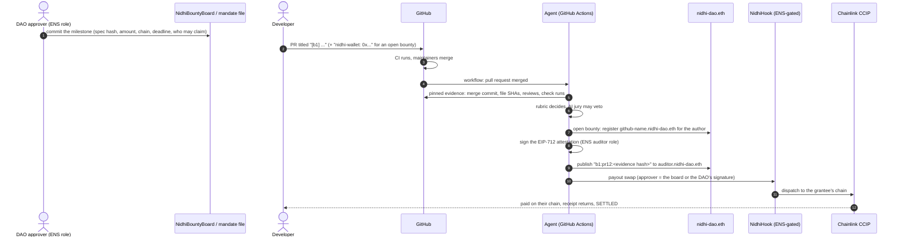
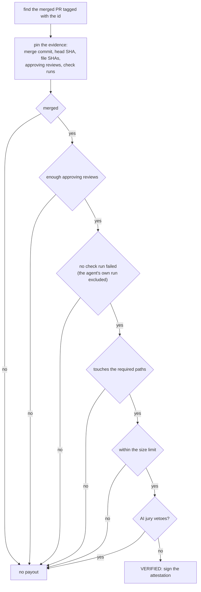
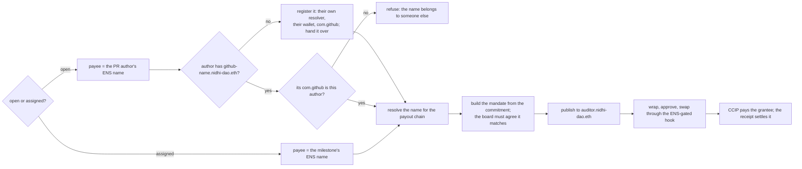

# The milestone agent

The agent pays developers for finished work without anyone pressing "send". It runs in GitHub Actions, verifies a merged
pull request against what the DAO committed to, and pays the developer on their chain. It holds no power on its own: every
payout still passes the hook, the DAO's commitment, ENS and the caps.

Contents: [1 the whole flow](#1-the-whole-flow) · [2 committing a milestone](#2-the-dao-commits-a-milestone) ·
[3 claiming it](#3-a-developer-claims-it) · [4 verification](#4-the-agent-verifies) · [5 payment](#5-the-agent-pays) ·
[6 limits on the agent](#6-what-the-agent-cannot-do) · [7 where it runs](#7-where-it-runs) · [8 the app](#8-the-milestones-screen) ·
[9 code](#9-code)

---

## 1. The whole flow

---

## 2. The DAO commits a milestone

The DAO commits **before the work exists**, so the agent can never decide what a milestone is worth or what it asks for.

| Path | How | Approver |
|---|---|---|
| **From the app** | Milestones → **New milestone** (open or assigned). The form checks the wallet's ENS approver role live, quotes the payout on Uniswap's V4Quoter, and posts to `NidhiBountyBoard` on-chain | the board contract, which holds the ENS approver role |
| **From the repo** | an entry in `offchain/milestones.json`, then `node offchain/src/milestone.ts commit <id>` | the approver key signs an EIP-712 mandate, saved in `offchain/mandates/` |

The committed **spec hash** covers the repo, the task text, who may claim, the payout chain, the amount and the rules. It
becomes the mandate's `evidenceHash`, so the hook ties the payout to exactly that spec. The app and the agent use the same
canonical-JSON hash; the agent refuses a milestone whose posted text does not match its committed hash.

---

## 3. A developer claims it

- Open a pull request whose title contains the milestone id: `[m1] ...` or `[b1] ...`.
- For an **open bounty**, add `nidhi-wallet: 0x...` to the description: the address to be paid, on the payout chain.
- **First come, first served:** of the merged PRs carrying the tag, the one merged earliest that passes wins. Merging is the
  DAO's selection, since only maintainers can merge.

---

## 4. The agent verifies

- **The rubric decides.** These rules are deterministic and fixed in the committed spec.
- **The jury can only veto.** Groq and Gemini models (others optional) read the diff against the task text.
- **The attestation** binds `evidenceHash` = the committed spec, and `inputsHash` = the SHA-pinned evidence (plus the winner
  for an open bounty). It is signed with the agent's key, which holds the auditor role on `nidhi-dao.eth`.

---

## 5. The agent pays

---

## 6. What the agent cannot do

| It cannot | Because |
|---|---|
| pay more, in another token, or on another chain | the commitment fixes them, and the hook and board check every field |
| pay someone else | the payee must be what the ENS name resolves to; an assigned milestone fixes the name; an open one can only pay the PR author's name |
| pay twice | one `grantId` per milestone, marked used by the hook |
| pay without a commitment | no approver signature or matching board milestone, no swap |
| pay at a bad price | the signed band, and on mainnet the StateView guard |
| outrun the treasury | the daily cap; the ENS guardian can pause everything |
| keep going after it is removed | revoking its ENS auditor role, or the board's approver role, stops it on the next swap |

---

## 7. Where it runs

`.github/workflows/agent.yml` runs the agent:

- when a pull request is **merged** (within about a minute);
- every 15 minutes as a fallback;
- by hand, for one milestone, optionally as a dry run.

It uses the repository's built-in `GITHUB_TOKEN` (read-only) and repository secrets for its testnet keys and the AI
providers. All of its reads and writes go through several RPC providers, so one rate-limited provider cannot block a
payout. Each run uploads its record as an artifact.

---

## 8. The Milestones screen

For each milestone the app shows, live:

1. the DAO's commitment (spec hash, who signed it, on-chain or from the repo);
2. the PR's state from GitHub (reviews, CI, merged);
3. the agent's verification, read from the hook's `GrantAuthorized` event on-chain;
4. the payout, read from the dispatcher, with a link to the full grant timeline.

DAO members with the ENS approver role see a **New milestone** button.

---

## 9. Code

| What | Where |
|---|---|
| The agent | [`offchain/src/agent.ts`](../../offchain/src/agent.ts) |
| Committing milestones from the repo | [`offchain/src/milestone.ts`](../../offchain/src/milestone.ts) · [`offchain/milestones.json`](../../offchain/milestones.json) · [`offchain/mandates/`](../../offchain/mandates/) |
| On-chain milestones and contributor names | [`offchain/src/bounty.ts`](../../offchain/src/bounty.ts) · [`offchain/src/post-bounty.ts`](../../offchain/src/post-bounty.ts) |
| The board | [`src/NidhiBountyBoard.sol`](../../src/NidhiBountyBoard.sol): [`post`](../../src/NidhiBountyBoard.sol#L79) · [`matches`](../../src/NidhiBountyBoard.sol#L116) · [`isValidSignature`](../../src/NidhiBountyBoard.sol#L130) |
| Evidence, rubric, spec hashes | [`offchain/src/lib.ts`](../../offchain/src/lib.ts) |
| The workflow | [`.github/workflows/agent.yml`](../../.github/workflows/agent.yml) |
| The app | [`ui/src/pages/Milestones.tsx`](../../ui/src/pages/Milestones.tsx) · [`ui/src/pages/NewMilestone.tsx`](../../ui/src/pages/NewMilestone.tsx) |
| Tests | [`test/unit/BountyBoard.t.sol`](../../test/unit/BountyBoard.t.sol) |
