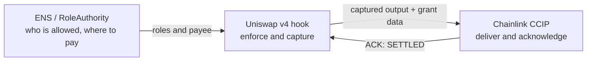

# Nidhi architecture diagrams

Three Mermaid diagram sets, one per technology. GitHub renders them directly. Each file has a system view, a sequence view
and a state or decision view, drawn from the contract code in `src/`.

| File | Layer | Answers |
|---|---|---|
| [01-ens.md](01-ens.md) | Identity and permissions | Who may approve, audit and pause, and where does `alice.dao.eth` get paid? |
| [02-uniswap-v4.md](02-uniswap-v4.md) | Execution and enforcement | How does a swap become a mandate-checked grant that captures its own output? |
| [03-chainlink-ccip.md](03-chainlink-ccip.md) | Cross-chain settlement | How do the funds reach another chain, and how does the source learn it was paid? |

How they connect: **ENS** answers "who is allowed", the **Uniswap v4 hook** enforces it inside the swap and captures the output,
and **CCIP** moves it and returns a receipt.

