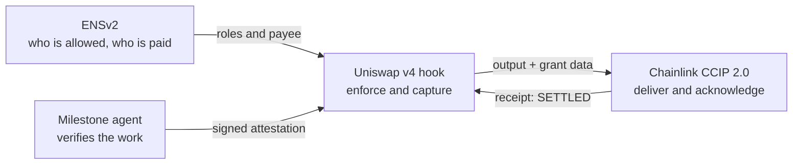

# Nidhi architecture

One deep dive per protocol, plus the agent. Each has system, sequence and state diagrams (Mermaid, rendered by GitHub),
live addresses, proof transactions and links to the exact code.

| Document | Layer | Answers |
|---|---|---|
| [01-ens.md](01-ens.md) | **ENSv2**: identity and permissions | Who may approve, audit and pause? Where is `alice.nidhi-dao.eth` paid on each chain? How does the agent get a name? |
| [02-uniswap-v4.md](02-uniswap-v4.md) | **Uniswap v4**: execution and enforcement | How does a swap become a checked grant that captures its own output? |
| [03-chainlink-ccip.md](03-chainlink-ccip.md) | **Chainlink CCIP 2.0**: cross-chain settlement | How does the money reach another chain, how does the source learn it was paid, and how is a chain with no lane reached? |
| [04-milestone-agent.md](04-milestone-agent.md) | **The milestone agent** | How does a merged PR become a payout, and why can the agent not misbehave? |

How they fit together:

